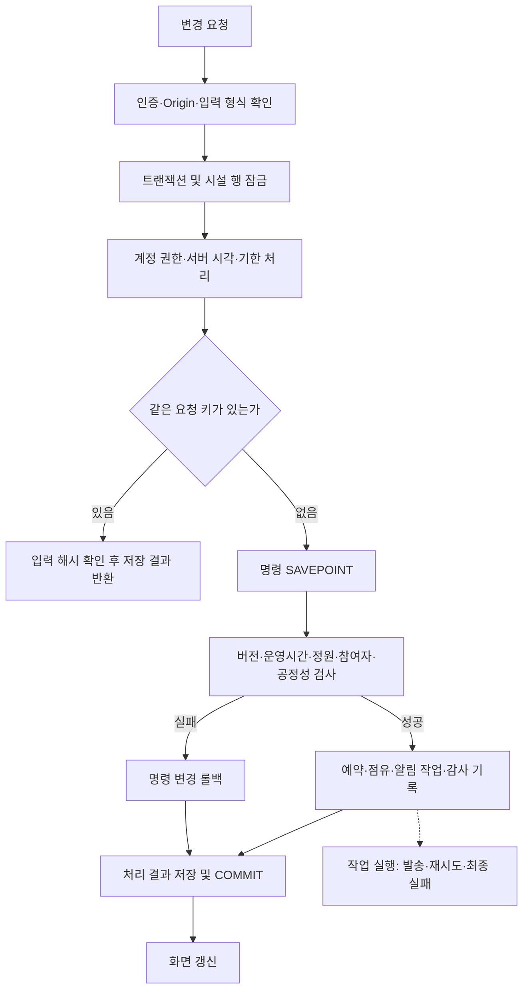

# 최종 릴리즈 전 전체 점검

점검일: 2026-09-29 (한국 시간)

**판정: 운영 출시 보류 — NO-GO.** 핵심 예약 기능의 로컬 검증은 통과했습니다. 실제 외부 인증·메일, 운영 인프라와 복구, 미완료 인수 항목이 남아 있어 전체 명세를 충족하는 최종 릴리즈로 판정할 수 없습니다. 개발 환경을 운영 모드로 바꾸거나 배포하지 않았습니다.

## 1. 실행한 검증과 결과

| 검증 | 결과 | 증거·한계 |
|---|---|---|
| 단위 검사 | 24개 통과 | 정책 경계, 공정성, 휴관 우선, 공휴일 파싱, 시간 선택, 관리자 CSV 검증 |
| PostgreSQL 통합 | 47개 통과 | 기존 41개 + 릴리즈 시나리오 6개. 별도 임시 DB 생성·삭제. 실제 사용자 DB 초기화 없음 |
| 기본 화면 | 통과, 스크린샷 7개 | 로그인·사용자·관리자 화면·모바일·요청 출처 검사 |
| 학생 UX | 통과 | 초안 유지, 날짜 전환, 오류 복구, 로그아웃 정리. 충돌은 모의 응답 |
| 두 학생 실제 예약 | 통과 | 샘플 계정 신청 → 자동 참여·확정 → 취소 → 양쪽 화면 갱신. 샘플 취소 이력만 남음 |
| 관리자 UX | 통과 | CSV 오류 차단, 선택 수, 확인 전 요청 미발송, 실패 시 입력 유지, 정책 요약. 파괴적인 변경은 모의 응답 |
| 공휴일 UI | 통과 | 임시 휴일 등록·반영·휴관 영향·제외·원본 복원 |
| API 보안·입력 | 통과 | 비로그인 차단, 다른 Origin 차단, JSON·크기 제한, OTP 일회성, 학생 관리자 접근·변경 거절, 잘못된 날짜, 캐시 금지, 로그아웃 |
| 운영 모드 스모크 | 통과 | 임시 3101 포트. APP_ENV=local이어도 NODE_ENV=production에서 로컬 인증 불가. 개발 메일함 404, 비로그인 401, 외부 인증 미설정 503. 실제 외부 서비스 성공 검증 아님 |
| 빌드·타입 | 통과 | Next production build 및 TypeScript 검사 |
| 운영 의존성 취약점 | 알려진 항목 0건 | npm audit --omit=dev 결과. 전체 보안 감사나 미공개 취약점 부재를 뜻하지 않음 |
| 로컬 동시 조회 | 50회 모두 성공 | 동시 10개, p50 186ms, p95 337ms, 최대 366ms. 개발 서버의 짧은 예열 후 측정이며 지속 부하·운영 수용량 증명 아님 |

검증 중 추가한 메일 실패 테스트의 SQL 파라미터 형식 오류도 수정했으며, 최종 실행은 47개 모두 통과했습니다.

## 2. 발견하여 수정한 결함

**위치:** `src/server/queries.ts`의 snapshot 조회.

**재현:** 2026-01-02처럼 과거 달력을 선택하면 2026-10-06의 예정된 내 예약과 자동 참여 목록이 빠졌습니다. 예약이 삭제된 것은 아니지만 사용자는 취소되었다고 오해할 수 있었습니다.

**원인:** 개인 예약 조회 상한이 선택한 날짜 +32일이어서 과거 선택 시 현재·예정 예약을 포함하지 못했습니다.

**수정:** 조회 상한을 오늘과 선택 날짜 중 늦은 날짜 +32일로 변경했습니다. 달력의 날짜별 공개 예약 필터와 참여자 공개 범위는 유지합니다. 신청자와 자동 참여자 양쪽을 검사하는 통합 테스트를 추가했고, 수정 전 실패·수정 후 성공을 확인했습니다.

## 3. 알고리즘 점검

| 항목 | 판단과 근거 |
|---|---|
| 동시성 | 모든 변경은 공통 설정 행 잠금을 획득한 트랜잭션 안에서 처리. 100건 같은 방 신청에서 정확히 1건 성공. 단일 시설에는 단순하나 쓰기 처리량 상한은 지속 부하 검증 필요 |
| 이중 예약 | 방은 PostgreSQL 배타 제약, 참여자는 member_claims 배타 제약. 비교 구간은 [시작, 종료)로 맞닿은 시간 허용. 서로 다른 방의 같은 참여자 동시 신청도 한 건만 허용 |
| 원자성 | 구성원 중 한 명이라도 자격·시간·공정성 위반이면 전체 명령 롤백. 방 이동·휴관 이동 실패 시 원래 예약과 방·버전 보존 확인 |
| 재전송 | 사용자·명령·요청 키별 영수증과 입력 해시. 동일 키 같은 입력은 같은 결과, 다른 입력 거절. 영수증은 7일 후 정리. 클라이언트 새로고침을 넘는 요청 키 영속화는 없음 |
| 공정성 | 공통 인원 / 작은 명단 인원 비율이 기준을 엄격히 초과할 때 같은 모임. 50% 허용·75% 차단, 59분 거절·60분 허용, 앞뒤 대칭 및 1440분 경계 검증 |
| 명단·상태 | 신규 예약은 검사 후 같은 트랜잭션에서 확정. 최초 명단·시작 명단 고정, 정각 마감, 보충 기한 재사용, 시작 후 학생 변경 금지, 종료 시 점유 해제 확인 |
| 정책 | 이용일 정책으로 전체 검증. 새 정책의 예약 창 확대로 미래 날짜가 일찍 열리는 동작은 명세 01 §14에 명시된 동작. 기존 예약 소급 취소 없음 |
| 권한 | 요청의 역할 값 대신 DB 계정 상태·역할·access_version 재검사. 관리자 계정 변경의 10분 재인증, 본인 회수 금지, 상호 회수 경쟁에서 활성 관리자 유지 확인 |
| 자동 작업 | 작업 임대 토큰·재시도와 최종 실패 기록. SMTP 미설정으로 4회 실패시켜 예약 유지와 FAILED 전환 확인. 외부 전송 성공 직후 프로세스 중단 시 중복 알림 가능성은 남음 |
| 공휴일 | 관리자 보정 우선, 공식 자료 일부 실패 시 이전 자료 보존. 표시와 시설 폐쇄 분리. 실 API 인증·응답은 키 미설정으로 미검증 |



## 4. 업무 워크플로우 점검

| 업무 | 이번 확인 결과 | 남은 조건 |
|---|---|---|
| 학생 로그인 → 신청 → 자동 참여 → 취소 | 실제 두 브라우저와 API에서 정상 | 실제 Supabase 이메일 인증·세션 만료 복구 |
| 이탈 → 보충 → 재확정 또는 마감 취소 | DB에서 정상, 첫 기한 유지 | 실제 사용자 알림 수신 |
| 책임 이전 | 상대 수락 시 책임자 변경, 시작 전 제한 확인 | 거절·이탈·기수 종료와의 조합 인수 확대 |
| 관리자 휴관 | 오래된 미리보기 차단, 이동 실패 롤백, 취소 시 점유 해제 정상 | 다수 영향 예약의 운영 담당자 실제 확인 |
| 학생 비활성화·기수 종료 | 책임 예약 취소, 참여 제거·보충, 기존 세션 차단, 관리자 보존 | 학생별 미래 영향 예약 전체 미리보기는 현재 명단·일반 경고 수준 |
| 관리자 초대·회수 | 계정 분리·재인증·버전·초대 무효화·동시 회수 코드와 테스트 확인 | 실제 최초 초대·재초대·복구 도구의 외부 인증 인수 |
| 신고 | 접수·처리완료 API 및 관리자 화면 구현 | 확인중·기각 상태, 학생 처리 결과 화면 미완료 |
| 계정 준비·알림 실패 | 재시도 및 최종 실패 이력, 예약 보존 확인 | 관리자 재처리 기능, 발송 후 장애 시 중복 수신 대응 |

## 5. 출시 차단 조건

| 우선순위 | 조건 | 현재 근거 | 완료 기준 |
|---|---|---|---|
| P0 | 실제 인증·메일·초대 연결 | Supabase·SMTP 미설정. 로컬 메일함만 사용 | 운영용 시험 계정으로 OTP 수신→로그인→관리자 초대 수락→회수→재초대 전 과정 성공 |
| P0 | 운영 환경·최소 권한 | APP_ENV=local, HTTP 주소, DB 계정에 강한 권한 존재 | HTTPS, 운영 환경, 앱 전용 최소 권한 DB 계정, 비밀키 관리 및 개발 데이터 제거 |
| P0 | 보존·파기 및 복구 | 기수 종료 후 90일 자동 파기·외부 Auth 삭제 미구현, 백업 복구 미검증 | 승인된 보존 정책 구현 및 별도 복원 환경에서 데이터 정합성·중복 작업 방지 실증 |
| P1 | 명세 미완료 범위 | Slack 내부 조회·신청·서명 검증·연결, 회의실 추가·비활성화, 신고 세부 상태, 휴관을 반영한 3운영일 계산 등 | 구현·인수 완료 또는 첫 릴리즈 제외 범위를 명시적으로 확정. 이번 점검이 범위 축소 승인을 대신하지 않음 |
| P1 | 운영 감시·성능·버전 고정 | 짧은 로컬 측정만 있음. health는 DB 연결만 확인. 소스가 Git 미추적 상태 | 지속 부하와 장기 실행, 작업 지연 경보, 프로세스 재시작·복구, 릴리즈 커밋·태그·아티팩트 확정 |

공휴일 자동 반영을 제공하는 출시라면 HOLIDAY_API_KEY 설정 후 실제 올해·다음 해 응답 및 실패 복구도 필수입니다. 현재 수동 등록 기능으로 이를 완료했다고 간주하지 않습니다. DB 권한은 이번 점검에서 변경하지 않았습니다.

## 6. 명세 AT 추적 범위

후속 변경명세 03의 자동 참여가 기존 수락 기반 AT보다 우선합니다. 아래 ‘검증’은 로컬·임시 DB 범위이며 전체 운영 인수 완료 표시가 아닙니다.

| AT | 상태 | 확인·남은 부분 |
|---|---|---|
| 01–02 | 검증 | 예약 창·마지막 슬롯·종료 초과 |
| 03–05 | 변경명세 적용·부분 검증 | 자동 참여·정원, 기존 HOLDING 기한·수락 호환, 동시 응답 |
| 06–08 | 검증 | 공통 비율, 간격, 앞뒤 순서 |
| 09 | 코드 검토·부분 | HOLDING 명단 공정성 제외; 신규 직접 확정으로 주요 흐름 대체 |
| 10–12 | 검증 | 추가 참여 실패 롤백·이탈 비소급·첫 보충 기한 |
| 13 | 부분 | 시간 변경 기한 단축·유지 코드 확인. 모든 책임 이전·자진 취소 조합 별도 인수 |
| 14–16 | 검증 | 개인 일정 충돌, 이동 롤백, 큰 방 최소 인원 |
| 17 | 부분 | 수락 시 책임 이전 검증. 모든 거절·이탈 조합 추가 필요 |
| 18–20 | 검증·부분 | 시작 후 학생 취소 차단·명단 고정, 이전 초대 차단, 외부 명단 비공개. 모든 역할별 필드 조합은 확대 필요 |
| 21 | 미완료 | 명령 재전송 방어는 검증, 실제 Slack 경로 미구현 |
| 22–24 | 검증 | 미래 정책·휴관 원자성, 비활성화 영향, SMTP 실패 4회 재시도·예약 보존 |
| 25 | 부분·출시 차단 | 기수 종료 동작 통과; 90일 파기·외부 Auth 정리 미구현 |
| 26 | 검증 | 학생 등록의 관리자 역할·이메일 혼입 거절 |
| 27–28 | 부분 | 발급·수락 조건 코드 검토. 실제 최초 관리자·만료 경계·외부 인증 인수 필요 |
| 29–34 | 검증·부분 | 이전 초대 무효, 자기 회수 금지, 상호 회수, 학생 혼입 차단, 재인증 및 학생 권한 차단. 취소·수락 모든 동시 조합과 재초대 후 과거 세션 인수 확대 필요 |
| 35 | 미검증 | 비공개 recovery CLI 존재. 실제 기관 확인·통지·외부 인증 복구 훈련 필요 |

## 7. 재현 명령과 산출물

```text
npm test
npm run test:db
npm run test:ui
npm run test:ui:ux
node tests/booking-browser.cjs
npm run test:ui:admin
npm run test:ui:holidays
npm run test:api:release
npm run build
npm run test:production:smoke
npm run release:check
```

동일 샘플 계정으로 인증을 반복하는 브라우저 검사는 30초 OTP 재발급 제한을 고려하여 순차 실행합니다. 운영 설정 검사는 차단 조건이 있으면 의도적으로 종료 코드 1을 반환합니다. 성공으로 우회하지 않습니다.

- `test-results/release-readiness.json`: 설정·DB·작업 상태. 현재 NO-GO, 실패·지연 작업 0건, heartbeat 정상.
- `test-results/release-api-metrics.json`: 로컬 동시 조회 측정.
- `test-results/release-dependency-audit.json`: 운영 의존성 npm audit 결과.
- `test-results/release-source-manifest.json`: 검사 시점 소스·테스트·빌드 설정 해시. 비밀 환경변수·로컬 DB 제외.

**다음 실행 단계:** 운영용 Supabase·SMTP·HTTPS·앱 전용 DB 환경을 구성하고 시험 계정으로 외부 인증·메일 인수를 수행합니다. 동시에 출시 차단 기능의 완료 또는 명세 범위 조정을 확정해야 합니다. 자격 증명은 채팅이 아니라 환경 설정에 입력합니다.
