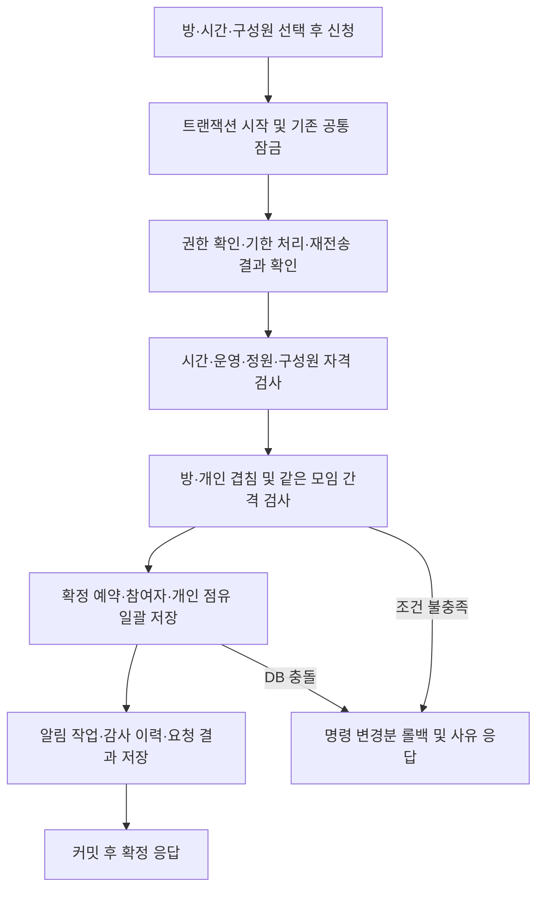

# 예약 절차·중복 예약 방지 단순화 검토

현재 구현을 기준으로 한 정적 검토다. 이번 검토에서는 서비스 코드나 예약 정책을 변경하지 않았다. 개선 효과의 시간·CPU 비율은 측정하지 않았다.

## 결론

학생의 신청 절차는 이미 ‘방·시간 선택 → 구성원 선택 → 신청 즉시 확정’이므로 추가 승인이나 수락 단계를 줄일 여지는 작다. 내부 처리는 신규 예약의 중간 상태, 반복 SQL, 중복 공정성 검사를 줄일 수 있다. 중복 방지의 핵심은 현재 DB 제약을 그대로 사용하는 것이 가장 단순하다.

## 우선 적용할 변경 5가지

| 순서 | 현재 코드 | 제안 | 주의할 조건 |
|---|---|---|---|
| 1 | `eligibility()`가 인원마다 계정·제재를 조회하고 create/invite가 인원마다 INSERT | 계정과 유효 제재를 각각 일괄 조회하고 참여자를 일괄 INSERT/UPSERT | 요청한 전원의 존재·학생 역할·활성 상태·제재 여부 검증. 한 명 실패 시 전체 롤백. 재초대 generation 증가 유지 |
| 2 | change에서 `fairness()` 실행 후 `settle()` 내부에서 다시 실행 | 최종 후보 상태에 대해 한 번만 검사 | 최소 인원 변화, 보충중→확정, 최초 확정 명단·시작 명단을 포함한 판정 동등성 확인 |
| 3 | 공정성 검사에서 앞뒤 1일의 예약을 모두 읽음 | 설정된 `gapMinutes`만큼 인접한 예약으로 SQL 범위 축소 | 현재 정책은 최대 1,440분. 같은 모임 비율과 앞뒤 대칭·정확한 간격 경계 유지 |
| 4 | 신규 예약을 HOLDING으로 INSERT한 뒤 settle로 CONFIRMED 전환 | 신규 생성 전용 경로에서 모든 검사를 통과한 CONFIRMED 예약을 한 트랜잭션으로 저장 | 최초 확정 시각·명단, 참여자 점유, 알림·감사 이력을 함께 저장. 기존 HOLDING 데이터는 별도 호환 경로 유지 |
| 5 | `boundaries()`가 이미 시작 명단을 고정한 진행 중 예약도 매 실행마다 조회 | 시작 명단이 아직 없는 예약, 종료 시각 도달 예약, 모집·보충 기한 도달 예약만 조회 | 시작 정각·종료 정각·보충 기한 정각 처리는 그대로 유지 |

1번의 계정·제재 조회와 참여자 INSERT 구간은 N명 기준 약 3N회에서 3회로 줄일 수 있다. 예를 들어 8명은 24회→3회다. 이는 해당 구간만 센 정적 계산이며 전체 예약 요청의 SQL 수나 실행 시간 감소율이 아니다. 신청자 선행 검사, 정책·충돌 검사, 알림·감사 기록은 별도다.

## 권장 예약 처리 흐름

중간 HOLDING을 없애더라도 검사와 저장을 별도 트랜잭션으로 나누면 안 된다. 후보 명단으로 공정성을 검사하고 최초 확정 명단도 저장해야 한다. 외부 이메일·Slack 전송은 현재처럼 커밋 후 작업 큐에서 처리한다. 이미 만료된 예약 정리는 실패한 신청과 함께 되돌리지 않도록 기존 SAVEPOINT 구조를 유지한다.

## 중복 방지는 네 문제로 구분

| 방지 대상 | 현재 방법 | 판단 |
|---|---|---|
| 같은 방의 겹치는 시간 | reservations의 방 ID + 시간 범위 EXCLUDE 제약 | 유지. 동시 요청에서도 DB가 최종 차단 |
| 같은 학생이 다른 방을 동시에 이용 | member_claims의 학생 ID + 시간 범위 EXCLUDE 제약 | 유지. 방 검사만으로 해결되지 않음 |
| 더블클릭·통신 재시도로 같은 신청 재실행 | 요청 키·입력 해시·저장된 결과, 생성 요청 키 유일성 | 유지. 시간 충돌과 재전송은 다른 문제 |
| 일부 인원을 바꿔 같은 모임이 연속 예약 | 최초 확정·현재 또는 시작 명단의 교집합 비율 및 간격 검사 | 규칙 유지, 중복 실행과 조회 범위만 축소 |

시간 겹침 공식은 이미 단순하다: `기존 시작 < 새 종료 AND 기존 종료 > 새 시작`. DB도 `[시작, 종료)` 범위를 사용하므로 18:00–19:00과 19:00–20:00은 시간 중복으로 보지 않는다. 다만 같은 모임 간격 정책은 별도로 적용되어 연속 예약이 거절될 수 있다.

서버의 방·개인 사전 SELECT를 제거하고 DB 제약 오류만 처리하는 방법도 가능하다. 그러나 현재 사전 검사는 ‘방이 겹침’과 ‘참여자 일정이 겹침’을 구분해서 안내한다. 제거하려면 제약 이름별 오류 변환과 회귀 검증이 필요하므로 우선순위는 낮다. 두 SELECT를 줄이기 위해 DB 제약 자체를 없애지는 않는다.

## 유지할 설계와 정책 경계

- **공통 잠금 유지:** 현재 모든 변경은 settings 한 행 잠금 아래 처리된다. 소규모 운영에서는 이해하기 쉬운 방식이다. 방별 잠금으로 바꾸면 서로 다른 방의 동일 학생·동일 모임 경쟁까지 다시 설계해야 한다. 실제 잠금 대기 병목을 측정하기 전에는 변경하지 않는다.
- **개인 점유 테이블 유지:** 참여자와 시간 정보가 다른 테이블에 있는 현재 구조에서 DB 차원의 개인 중복 방지를 맡는다. 삭제하면 조인 기반 검사나 다른 저장 구조가 필요해진다. 현재 DELETE→INSERT 재동기화도 소수 인원에서는 이해하기 쉬우므로 미세한 차분 갱신은 우선하지 않는다.
- **기존 모집·초대 호환 유지:** 신규 생성에서 HOLDING을 생략하는 것과 기존 상태·명령·기한 필드를 삭제하는 것은 다르다. 기존 대기 데이터의 전환 검토 없이 `respond`, `revoke`, HOLDING 관련 처리를 삭제하지 않는다.
- **보충 절차 유지:** 참여 취소로 최소 인원이 부족해지면 기존 10분 보충 절차를 유지한다. 즉시 취소로 바꾸면 코드는 줄지만 학생에게 불리한 정책 변경이다. 책임 이전의 상대방 수락도 유지한다.
- **공정성 명단 유지:** 최초 확정·시작 명단을 제거하거나 개인별 하루 횟수 제한으로 대체하면 동일 모임 우회 방지 기준이 달라진다. 이번 단순화 범위에 넣지 않는다.

## 구현 후 필요한 검증

기존 14개 단위·33개 DB 통합·브라우저 검사를 기반으로 다음을 보강한다.

1. 같은 방 동시 신청과 서로 다른 방의 공통 참여자 동시 신청에서 유효 예약이 중복 생성되지 않는지 확인한다.
2. 같은 요청 키 재전송은 같은 결과, 다른 입력을 같은 키로 보내면 거절되는지 확인한다.
3. 일괄 추가 중 한 명의 자격·일정 실패가 전원 추가를 취소하고, 재초대 세대 번호를 보존하는지 확인한다.
4. 50% 경계, 59분·60분 경계, 앞뒤 예약, 시간 변경·추가 초대·보충 후 확정에서 공정성 결과가 유지되는지 확인한다.
5. 신규 확정의 최초 명단·알림·점유, 기존 HOLDING 처리, 시작·종료·보충 만료 경계를 확인하고 같은 인원수·데이터로 SQL 호출 수를 전후 비교한다.

다음 구현은 반복 SQL 일괄 처리와 중복 공정성 검사 제거부터 시작하는 것을 권장한다. 신규 생성의 직접 확정 전환은 위 검증을 확장한 다음 적용한다.

## 확인한 코드

- `src/server/booking.ts`: checkPeriod, individual, eligibility, fairness, settle, boundaries, create/change/invite.
- `src/server/policy.ts`: overlaps, sameGroup, rosterSets, checkFairness.
- `src/server/commands.ts`, `src/server/db.ts`: 요청 재전송 처리, SAVEPOINT, 공통 잠금.
- `db/migrations/001_initial.sql`: 방·개인 시간 중복 제약과 요청 키 유일성.
- `src/server/admin.ts`: 학생 비활성화·제외·휴관 경로에서 공유하는 상태 정리.
