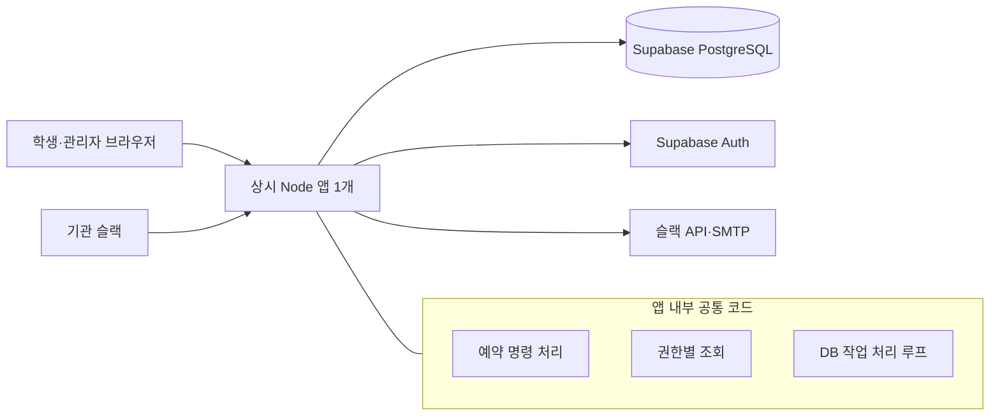

> 2026-09-29 변경: 참여자 자동 참여 및 공휴일 날짜 선택은 [변경 명세](./03-자동참여-공휴일-변경명세.md)를 우선 적용합니다.

# 시스템 구현 명세 v1.1

작성일: 2026-09-22 · 상위 문서: [최종 개발명세서](./00-최종개발명세서.md)

이 문서는 [기능 구현 명세](./01-기능구현명세.md)의 동작을 보장하는 구현 기준이다. 기능 정책을 별도 해석하거나 HTTP·슬랙별로 다르게 구현하지 않는다.

## 1. S-01 구성과 경량화 범위

| 구성 | 구현 기준 |
| --- | --- |
| 웹·API | Next.js App Router + React + TypeScript, Node 런타임 |
| 스타일 | Tailwind CSS, 필요한 접근성 컴포넌트만 도입. 시간표 직접 구현 |
| DB | Supabase 관리형 PostgreSQL, btree_gist 확장 |
| DB 접근 | node-postgres의 pg, 매개변수화 SQL, 순서가 있는 SQL 마이그레이션 |
| 로그인 | Supabase Auth 이메일 OTP, 서버 인증 통합 |
| 운영 배포 | Render의 상시 실행 Web Service 1개, 운영용 DB·인증과 SMTP |
| 검증 | Vitest, 실제 PostgreSQL 통합검사, Playwright의 핵심 사용자 흐름 |

직접 배포하는 앱은 한 개다. 작업 루프를 별도 서비스로 배포하지 않는다. Redis·메시지 브로커·웹소켓·다기관 공유 DB·범용 플러그인 구조는 만들지 않는다. 기존 프레임워크에서 기본 제공하는 입력·라우팅·빌드 기능을 우선 사용한다.

의존성은 개발 착수 시 서로 호환되는 안정 버전으로 고정한다. 운영과 통합검사 DB의 주 버전을 맞춘다. 이 명세는 특정 최신 버전 번호나 아직 측정하지 않은 성능을 보장하지 않는다. Next.js의 Node 서버 배포를 사용한다. [공식 배포 문서](https://nextjs.org/docs/app/getting-started/deploying)

## 2. S-02 코드 책임과 파일 배치

| 위치 | 책임 |
| --- | --- |
| src/app | 화면과 HTTP 진입점. 입력 변환·인증·응답 처리 |
| src/server | booking, policy, admin, db, integrations, jobs 기능별 코드 |
| src/instrumentation.ts | 운영 Node 서버의 작업 루프 시작점 |
| db/migrations, db/seeds | 스키마 변경과 가상 초기 데이터 |
| tests | 정책·실제 DB·브라우저 검사 |

화면이나 슬랙 핸들러에 정원·공정성 규칙을 복제하지 않는다. 공통 예약 서비스는 입력, 인증된 행위자, 현재 데이터를 받아 정책 계산과 저장을 수행한다. 정책 계산 함수는 외부 API를 호출하지 않는다.

작업 루프도 같은 예약 서비스를 사용한다. 서버에 반영되지 않은 프런트엔드 검사 결과는 예약 성공 근거가 아니다. 한 구현만 있는 인터페이스·팩토리·범용 규칙 엔진을 만들지 않는다.

## 3. S-03 실행 환경과 초기 데이터

개발은 Node와 로컬 PostgreSQL 컨테이너를 기본으로 하며 로컬 DB를 사용할 수 없으면 개발 전용 DB로 대체한다. 운영 계정·DB·슬랙과 시험 환경을 분리한다. 공개 데모에 실제 학생을 사용하지 않는다.

초기 seed는 관리자 1명, 가상 학생 8명, 4인실 4개·8인실 1개, Asia/Seoul, 평일 18:00~21:30, 기능 명세 기본 정책을 생성한다. 부하검사용 가상 계정은 별도로 200명까지 만든다.

위 관리자 seed는 개발·시험 환경에서만 허용한다. 운영 최초 관리자는 S-14의 일회성 등록과 본인 초대 수락으로 생성한다. 운영에서 시험용 계정을 자동 생성하거나 기본 관리자 비밀번호를 배포하지 않는다.

| 환경설정 묶음 | 내용 |
| --- | --- |
| 앱·DB | APP_BASE_URL, DATABASE_URL, MIGRATION_DATABASE_URL, 배포 환경 구분 |
| 인증 | Supabase URL·공개 키·서버 관리 키, 허용 리다이렉트 |
| 알림 | SMTP 접속·발신 정보, Slack bot token·signing secret·허용 workspace |
| 작업 | RUN_JOBS, 작업 동시 실행 수·timeout·lease 기본값 |
| 보안·운영 | 일회용 연결 코드 보호용 비밀값, 앱 인증 컨텍스트 서명 키, 로그 수준, 백업·모니터링 설정 |

비밀값은 서버 환경설정으로만 주입한다. 브라우저 번들에 DB URL·관리 키·SMTP 비밀번호·Slack token을 넣지 않는다. 운영과 개발의 키를 공유하지 않는다. 인증용 SMTP와 일반 알림 SMTP는 같은 제공자를 사용할 수 있으나 각각의 발송 결과를 검증한다.

## 4. S-04 데이터 모델 — 업무 테이블 14개

UUID 식별자, timestamptz 시각, 필요한 생성·수정시각을 사용한다. 아래는 필수 필드와 관계이며 구현 편의를 위한 인덱스·생성 열은 마이그레이션에서 추가할 수 있다. 이메일은 공백 제거·정규화 후 저장하고 원래 표시값은 필요할 때 별도로 보관한다.

### 시설·회원·정책

| 테이블 | 주요 필드 | 관계·제약 |
| --- | --- | --- |
| settings | id, facility_name, timezone, allowed_workspace_id, schema/config version, job heartbeat, admin_bootstrap_started_at, bootstrap_admin_id | id=1인 단일 행. 업무 쓰기의 직렬화 잠금 지점. 초기 관리자 등록 표식은 일반 설정 API로 수정 불가 |
| cohorts | id, name, starts_on, ends_on, inactive_at | 기수 종료·보존 기준 |
| members | id, auth_user_id, cohort_id nullable, email, display_name, class_name, role, status, account_version, access_version, cooldown_until, slack_workspace_id, slack_user_id, link_code_hash·expires_at·attempts, admin_invite_id·issuer_type·invited_by·expires_at·accepted_at·revoked_at | email·auth_user_id 고유. role은 STUDENT 또는 ADMIN. 학생 cohort 필수·관리자 cohort 없음. 유효 Slack workspace/user 조합과 비어 있지 않은 admin_invite_id 고유 |
| rooms | id, name, active, display_order | 삭제 대신 비활성화. 이름 변경과 정책 변경을 구분 |
| policy_versions | id, effective_on, rules_json, created_by, created_at | 적용일 고유. rules에 방별 정원·최소 인원과 요일 구간·각 정책값. 저장 후 불변 |
| opening_exceptions | id, local_date, room_id nullable, kind, local_start·local_end, reason, version | room 없음은 시설 단위. 전체 휴관 우선. 날짜·범위의 충돌 검증 |

신규 회원 provisioning 상태는 REGISTERED, PROVISIONING, ACTIVE, INACTIVE, FAILED로 구분한다. Auth와 내부 등록이 모두 준비된 ACTIVE 상태만 업무 기능을 사용할 수 있다. 이용 제한은 sanctions로 별도 판정한다.

관리자 ACTIVE에는 유효 초대의 본인 수락 조건도 필요하다. MEMBER_PROVISION은 관리자 Auth 계정 준비만 수행하며 초대 수락 전 자동 활성화하지 않는다. 관리자 초대 대기·만료·취소는 invitation 필드에서 계산하고 관리자 업무 권한과 구분한다. 회수된 관리자는 INACTIVE이며 재초대 수락 전까지 유지한다.

학생의 cohort_id는 현재 소속이다. 과거 예약·신고·감사 이력에는 당시의 cohort_id를 보존한다. 같은 이메일 학생의 재등록은 관리자 명시적 작업으로 현재 소속을 갱신하되 과거 기록의 기수를 덮어쓰지 않는다. 활성 재등록 학생의 계정을 과거 기수 보존기간 만료만으로 삭제하지 않는다. 관리자 계정과 관리자 계정 관리 사건은 cohort_id를 null로 두고 학생 기수 정리 대상에서 제외한다.

### 예약

| 테이블 | 주요 필드 | 관계·제약 |
| --- | --- | --- |
| reservations | id, cohort_id, room_id, creator_id, organizer_id, policy_version_id, capacity_snapshot, minimum_snapshot, starts_at, ends_at, status, initial_deadline, replenish_deadline nullable, first_confirmed_at, first_confirmed_member_ids, start_member_ids, start_snapshot_at, version, cancel_reason, create_request_key, transfer_request_id·from_id·to_id·expires_at | room/member/policy 참조. 시작<종료. creator·create_request_key 고유. 스냅샷은 서로 독립적으로 한 번 저장 |
| reservation_members | id, reservation_id, member_id, invited_by, status, invitation_generation, responded_at | reservation·member 고유. 재초대는 세대 증가. 수락자·초대 관계를 기록 |
| member_claims | reservation_id, member_id, during | reservation·member 고유. 같은 학생의 시간 범위 겹침 배제 |

방 점유는 reservations의 상태 조건부 배제 제약으로 보장한다. 별도 room_claims를 만들지 않는다. 책임 이전은 예약당 유효 요청 한 건의 필드로 저장하고 과거 요청은 감사 이력에 남긴다. first_confirmed_member_ids와 start_member_ids는 정렬·중복 제거한 UUID 배열이며 일반 변경 API에서 직접 수정할 수 없다. 실제 출석 필드는 없다.

reservation_members 상태는 INVITED, ACCEPTED, DECLINED, REVOKED, LEFT, EXPIRED다. 상위 예약의 취소·종료 후 ACCEPTED 기록을 이력으로 남길 수 있지만 유효한 개인 점유는 member_claims와 상위 예약 상태로 판단한다. 취소된 예약의 대기 초대는 REVOKED, 시작시각이 지난 확정 예약의 대기 초대는 EXPIRED로 정리한다.

### 운영·작업

| 테이블 | 주요 필드 | 역할 |
| --- | --- | --- |
| reports | id, cohort_id, reservation_id, reporter_id, type, detail, status, resolution, resolved_by | 신고·처리 결과. 신고자는 본인 것만 조회 |
| sanctions | id, cohort_id, member_id, kind, starts_at, ends_at, reason, created_by, revoked_at | 안내·기간 있는 이용 제한·해제 기록 |
| audit_events | id, cohort_id, actor_id, action, entity_type·id, before_summary, after_summary, reason, decided_at, request_id | 필요한 변경 근거만 저장. 인증정보·전체 HTTP 원문 제외 |
| command_receipts | actor_id, command_type, idempotency_key, request_hash, status, result_summary, created_at, expires_at | 주체·명령·키 고유, 같은 키 다른 내용 거절 |
| tasks | id, kind, dedupe_key, payload, recipient_id·channel nullable, status, attempts, next_run_at, lease_until, lease_token, result_summary, last_error_code, created_at | 슬랙 수신 명령·회원 준비·수신자별 알림·정리 작업을 한 구조로 관리 |

tasks는 SLACK_COMMAND, MEMBER_PROVISION, NOTIFY, RETENTION 종류를 사용한다. 알림은 수신자·채널별 한 행이다. 입력 payload는 서버에서 유형별로 검증한다. 데이터 구조 통합을 범용 외부 코드 실행 기능으로 확장하지 않는다.

주요 인덱스는 reservations의 시작·종료·유효 상태, reservation_members의 학생·상태, opening_exceptions의 날짜·방, tasks의 처리 상태·next_run_at, sanctions의 학생·기간에 둔다. 운영 조회 근거 없이 인덱스를 추가하지 않는다.

## 5. S-05 시간·상태와 명단 처리

DB 예약 상태는 HOLDING, CONFIRMED, REPLENISHING, CANCELLED, ENDED다. '이용 시간 도래'는 CONFIRMED와 시각으로 계산한다. 날짜 경계·예약 창·운영 구간은 기관 시간대로 계산한 뒤 절대시각으로 변환한다.

| 조건 | 상태 정리 |
| --- | --- |
| HOLDING이고 판정시각 >= initial_deadline | CANCELLED, 점유 제거, 해당 제한·알림 기록 |
| REPLENISHING이고 판정시각 >= replenish_deadline | CANCELLED, 점유 제거, 해당 제한·알림 기록 |
| CONFIRMED이고 시작 도달·시작 스냅샷 없음 | 현재 수락자에서 start_member_ids 고정, 대기 초대·이전 요청 만료 |
| CONFIRMED이고 종료 도달 | 시작 스냅샷을 먼저 보장한 뒤 ENDED, 개인 점유 제거 |
| 취소·종료 | 예약과 감사 이력은 남기고 더 이상 신규 점유로 취급하지 않음 |

모든 상태 변경 명령은 먼저 같은 시각 기준으로 필요한 경계를 정리한다. 관리자 시작 후 변경도 예외가 아니다. 서버 재시작 후 과거 시작시각과 종료시각이 모두 지났다면 시작 명단을 먼저 저장한 뒤 종료한다. 그 사이의 모든 변경이 같은 경계 정리를 거쳤어야 하므로 뒤늦은 현재 명단으로 과거 사실을 덮어쓰지 않는다.

모집·보충 기한 만료는 최소 인원 미달 예약을 시작 스냅샷으로 고정하는 처리보다 우선한다. 보충 마감은 한 번만 부여하고 확정 복귀 시 null로 초기화하지 않는다. 앞당긴 시작시각은 최초·보충 기한의 상한을 낮출 수 있으나 뒤로 이동한다고 기한을 늘리지 않는다.

정기 정리 지연에도 조회는 기한과 상태의 유효성을 계산해 빈 구간을 표시한다. 새 신청 전에 동일한 정리를 저장하여 오래된 상태의 DB 배제 제약이 계속 신규 예약을 막지 않게 한다. 읽기 응답과 변경 검증에서 경계 계산 함수를 공유한다.

최초 확정·시작 스냅샷은 일반 수정 경로에서 불변이다. 보존기간에 따른 삭제는 별도 정리 경로로만 수행한다. 판정 명단은 식별자 집합으로 비교하고 비율은 정수식 `commonCount * 10000 > smallerCount * thresholdBps`를 사용한다. 허용되지 않는 빈 명단·최소 인원 미달 명단은 F-07에 따라 제외한다.

## 6. S-06 동시성·트랜잭션·DB 제약

### 단일 쓰기 규약

예약·초대·정책·회원 상태·제재·시간 경계 정리는 같은 DB 연결의 트랜잭션에서 settings id=1 행을 FOR UPDATE로 잠근 뒤 실행한다. 모든 업무 쓰기에 적용한다. 조회와 외부 알림 전송에는 이 잠금을 잡지 않는다. tasks의 작업 선점은 짧은 별도 트랜잭션에서 완료한 뒤 예약 명령을 실행한다.

`ponytail: 단일 설치의 업무 쓰기를 한 행 잠금으로 직렬화한다. 실제 부하검사에서 처리량 목표를 충족하지 못하면 병목 SQL을 먼저 개선하고 이후 잠금 범위를 분리한다.`

판정시각은 잠금 획득 후 DB의 clock_timestamp()로 읽고 해당 명령에서 일관되게 사용한다. 네트워크 수신시각이나 트랜잭션 시작에 고정된 now()를 마감 판정에 사용하지 않는다. 이 시각보다 앞서 마감되었으면 거절한다. 이미 접수된 슬랙 작업도 실행 시점에 같은 규칙을 적용한다.

### 처리 순서

1. 신원·입력 형식을 검증하고 DB 트랜잭션과 설정 행 잠금을 획득한다.
2. 판정시각으로 경계를 정리하고 저장점을 둔다. 중복 키·현재 역할·상태·예약 버전을 확인한다.
3. F-규칙을 검증하고 예약·참여·개인 점유·스냅샷 변경을 계산한다.
4. 상태·감사 이력·작업·명령 결과를 함께 저장하고 커밋한다. 업무 거절은 요청 변경만 되돌리고 정당한 경계 정리와 거절 결과를 커밋한다.
5. 커밋된 결과를 반환한다. 외부 전송은 이 트랜잭션 밖에서 실행한다.

DB 예외로 트랜잭션이 실패 상태가 되면 저장점으로 복귀하거나 전체 롤백한다. 데이터 상태를 확신할 수 없는 실패는 성공 응답하지 않는다. 변경 중 확보 실패가 기존 방·시간을 해제한 채 끝나면 안 된다. 같은 트랜잭션에서 pool.query를 섞지 않고 하나의 pg client를 사용한다. [node-postgres 트랜잭션](https://node-postgres.com/features/transactions)

### DB 제약

| 대상 | 제약 |
| --- | --- |
| reservations | status가 HOLDING·CONFIRMED·REPLENISHING일 때 같은 room_id의 tstzrange(starts_at, ends_at, '[)') 겹침 배제 |
| member_claims | 같은 member_id의 during 겹침 배제. 비어 있거나 무한한 범위 금지 |
| 예약·참여 | 시작<종료, 정원·최소 인원 유효값, 예약·학생 중복 금지, 자기 자신 중복 초대 금지 |
| 명령·작업 | 명령 중복 키와 tasks dedupe_key 고유 |
| 스냅샷·이전 | 최초 확정/시작 기록과 배열의 함께 존재 조건, 이전 상대와 현재 책임자 일치 검증 |

범위 제약은 btree_gist와 GiST EXCLUDE를 사용한다. 부분 배제 조건은 정적 상태값만 사용하고 현재시각을 넣지 않는다. 정원·공정성은 잠금 안의 최신 데이터로 검사한다. [PostgreSQL 범위 제약](https://www.postgresql.org/docs/current/rangetypes.html#RANGETYPES-CONSTRAINT)

자동 재시도는 동일 요청 키를 유지한 기술적 일시 실패만 제한적으로 수행한다. 정책 위반·만료·권한 오류는 자동으로 반복하지 않는다. 처리 순서는 DB 잠금·커밋 순서이며 네트워크 선착순이나 엄격한 FIFO를 약속하지 않는다.

## 7. S-07 명령 중복·오래된 화면

변경 API는 Idempotency-Key를 받는다. 키는 주체·명령 종류와 묶고 대상 ID·세대·요청 내용을 정규화한 해시를 저장한다. 같은 키·내용은 원래 처리 결과를 반환하고, 같은 키·다른 내용은 거절한다. 명령 결과는 민감한 전체 상세 응답 대신 최소 식별자·결과·버전만 보존하고 반환 때 현재 접근권한을 확인한다.

예약 최초 생성은 reservations의 create_request_key도 고유하게 보존해 명령 영수증 정리 이후 같은 생성 키가 중복 예약을 만들지 않게 한다. command_receipts는 기본 7일, 작업과 감사 이력은 목적에 필요한 기간 및 F-15 한도 안에서 정리한다.

시간 변경·전체 취소·책임 이전·관리자 수정은 expectedVersion을 받아 오래된 화면의 의도치 않은 덮어쓰기를 막는다. 초대 수락·거절은 invitation_generation을 확인하고 다른 학생 수락으로 예약 version이 증가했다는 이유만으로 거절하지 않는다. 최신 정원·개인 일정·공정성은 다시 검사한다.

이전 초대를 취소하고 같은 사람을 재초대하면 invitation_generation을 증가시킨다. 수락 버튼의 사용자·예약·초대 ID·세대가 모두 맞아야 한다. 이미 수락된 같은 초대의 반복 수락은 현재 결과를 반환하고 두 번째 참여를 만들지 않는다.

## 8. S-08 API 계약

### 공통 계약

JSON 본문을 사용하고 시각은 시간대가 명시된 ISO 8601, 식별자는 UUID, 날짜 조회는 기관 현지 YYYY-MM-DD를 사용한다. actorId·role은 세션에서 결정한다. 클라이언트가 보낸 역할·최초 신청자·기준 명단을 신뢰하지 않는다.

성공 응답은 `data, serverTime, requestId`이고 변경 결과에는 `reservationId, version, state`를 포함한다. 오류는 `error: {code, message, fieldErrors?, retryAt?}, serverTime, requestId` 형식이다. 정책상 거절은 409 또는 입력 조건의 422, 비인증은 401, 권한 부족은 403, 존재 여부를 숨겨야 하는 자원은 404, 일시 처리 불가는 503으로 반환한다.

| 오류 코드 | 의미 |
| --- | --- |
| ROOM_UNAVAILABLE / MEMBER_TIME_CONFLICT / CAPACITY_REACHED | 방·개인 일정·정원 충돌 |
| GROUP_GAP_REQUIRED / MINIMUM_NOT_MET | 공정성 간격·변경 후 최소 인원 위반 |
| INVITATION_EXPIRED / RESERVATION_STARTED | 기한 만료·시작 후 금지 행동 |
| BOOKING_COOLDOWN / MEMBER_RESTRICTED | 신규 신청 또는 이용 제한 |
| STALE_VERSION / STALE_INVITATION / IDEMPOTENCY_MISMATCH | 오래된 내용·초대 또는 중복 키 불일치 |
| OUTSIDE_BOOKING_WINDOW / OUTSIDE_OPENING_HOURS / INVALID_INPUT | 예약 가능 날짜·운영 구간·입력 오류 |
| SERVICE_BUSY | 일시적 처리 실패. 같은 키로 상태 확인·재시도 |

다른 모임의 비공개 구성원을 오류 응답에 넣지 않는다. 각 오류에 가능한 다음 행동을 화면에서 연결한다.

### 학생 API

| 방식·경로 | 주요 입력 | 결과·용도 |
| --- | --- | --- |
| POST /api/auth/otp/request | email | 일반화된 발송 안내, 임의 계정 생성 없음 |
| POST /api/auth/otp/verify | email, token | 검증된 세션과 활성 학생 여부 |
| POST /api/auth/logout | 없음 | 세션 종료 |
| GET /api/schedule | date | 방·운영 구간·공개 예약 요약 |
| GET /api/members/search | q | role=STUDENT인 초대 가능한 활성 학생의 최소 정보. 관리자 제외 |
| GET /api/me/reservations | from, to, cursor | 본인 예정·과거 예약 |
| GET /api/me/invitations | cursor | 본인 응답 대상·상태 |
| GET /api/reservations/:id | 없음 | F-02 역할별 상세·allowedActions |
| POST /api/reservations | roomId, startsAt, endsAt, inviteeIds | HOLDING 예약 생성 |
| POST /api/reservations/:id/change | roomId, startsAt, endsAt, expectedVersion | 검증 후 예약 이동·변경 |
| POST /api/reservations/:id/cancel | expectedVersion | 학생 전체 취소 |
| POST /api/reservations/:id/invitations | inviteeIds, expectedVersion | 대기 초대 추가 |
| POST /api/invitations/:id/accept | invitationGeneration | 수락·최초 확정·재확정 |
| POST /api/invitations/:id/decline | invitationGeneration | 본인 거절 |
| POST /api/invitations/:id/revoke | invitationGeneration | 권한 있는 초대 취소 |
| POST /api/reservations/:id/leave | expectedVersion | 본인 참여 취소 |
| POST /api/reservations/:id/transfer | targetMemberId, expectedVersion | 책임 이전 요청 |
| POST /api/reservations/:id/transfer/respond | transferRequestId, response | 상대의 accept 또는 decline |
| POST /api/reports | reservationId, type, detail | 신고 접수 |
| GET /api/me/reports | cursor | 본인 신고와 처리 결과 |
| POST /api/slack/link-code | 없음 | 짧은 유효기간의 일회용 연결 코드 |

학생 변경 API는 S-07 중복 처리를 적용한다. 인증 발송은 별도 발송 제한을 적용하고 이전 성공 응답을 돌려준다고 OTP를 무조건 재발송하지 않는다. 학생 예약 명령의 처리 성공과 로그인 메일 접수는 구분한다.

### 관리자·슬랙 API

| 경로 묶음 | 방식과 역할 |
| --- | --- |
| /api/admin/members/import/preview, /import | POST: 행 오류·중복 미리보기, 유효 행 등록. 실행 시 재검증 |
| /api/admin/members, /:id/deactivate/preview, /:id/deactivate | GET·POST 목록/추가, POST 영향 조회·비활성화 |
| /api/admin/accounts, /api/admin/accounts/invitations | GET 관리자 목록, POST 관리자 초대. S-14 적용 |
| /api/admin/accounts/:id/invitation/resend, /api/admin/accounts/:id/invitation/revoke | POST 초대 재발송·취소. 현재 invitationId·accountVersion 확인 |
| /api/admin/accounts/:id/deactivate, /api/admin/accounts/:id/reinvite | POST 관리자 회수·재초대. 사유·최근 재인증 필요 |
| /api/admin/onboarding, /api/admin/onboarding/accept | GET 본인 관리자 초대, POST 본인 수락. 미활성 계정에 허용되는 제한된 경로 |
| /api/admin/reauth/request, /api/admin/reauth/verify | POST 현재 관리자 이메일에 코드 발송·재인증. 다른 계정으로 바꾸는 입력은 받지 않음 |
| /api/admin/cohorts, /api/admin/cohorts/:id/close/preview, /api/admin/cohorts/:id/close | GET·POST 기수 조회/등록, POST 종료 영향 조회·일괄 종료 |
| /api/admin/rooms, /api/admin/rooms/:id | GET·POST 목록/추가, PATCH 표시 정보·비활성화. 예약 영향은 실행 전 확인 |
| /api/admin/policies, /api/admin/policies/preview | GET·POST 정책 조회/새 버전, POST 적용일·영향 미리보기 |
| /api/admin/closures/preview, /api/admin/closures | POST 영향 조회·휴관 실행 |
| /api/admin/opening-exceptions, /api/admin/opening-exceptions/:id | GET·POST 예외 조회/등록, PATCH·DELETE 변경/제거. 영향과 사유 확인 |
| /api/admin/reservations/:id/change, /cancel, /members | POST 사유 있는 관리자 변경·취소·구성원 정정 |
| /api/admin/reports, /api/admin/reports/:id/resolve | GET 신고 목록, POST 처리 결과 |
| /api/admin/sanctions, /api/admin/sanctions/:id/revoke | GET·POST 목록/적용, POST 해제 |
| /api/admin/audit, /api/admin/tasks, /api/admin/tasks/:id/retry | GET 이력·실패 작업, POST 안전한 재시도 |
| /api/integrations/slack/commands, /interactions, /options | POST 서명 검증된 명령·버튼/모달·학생 검색 |
| /api/health/live, /api/health/ready | GET 프로세스와 DB·초기화 상태. 개인·비밀정보 비노출 |

표의 축약 경로는 앞의 같은 기본 경로에 이어진다. 예를 들어 /api/admin/reservations/:id/cancel이다. 기존 업무·계정에 대한 관리자 변경은 reason과 현재 version을 포함한다. 신규 초대는 사유를 받되 아직 없는 대상의 version은 요구하지 않는다. 본인 초대 확인·수락과 재인증은 각 전용 경로의 조건을 적용한다. 미리보기 결과는 실행 권한이나 최신성 보장이 아니므로 실행 트랜잭션에서 다시 검사한다.

학생 목록·등록·import·비활성화 API는 대상 role=STUDENT를 강제하고 role 입력으로 승격하지 않는다. 관리자 계정 API는 대상 role=ADMIN만 처리한다. 관리자 계정 수정의 version은 members.account_version이다. 역할을 임의 변경하는 범용 PATCH API를 제공하지 않는다. 공개 HTTP 경로에 최초 관리자 등록·운영자 복구 API를 만들지 않는다.

## 9. S-09 조회·프런트엔드

역할별 조회 응답을 서버에서 분리한다. 프런트엔드가 숨길 목적으로 전체 명단을 미리 받지 않는다. 최초 시간표는 한 번의 묶음 조회로 방과 운영 구간·예약을 반환한다. 방별 반복 조회와 학생별 추가 조회를 피한다.

활성 탭은 3초 간격으로 갱신하고 비활성 탭은 멈춘다. 다시 활성화되거나 본인이 변경을 완료하면 즉시 조회한다. 요청이 진행 중이면 같은 화면의 다음 조회를 겹쳐 보내지 않는다. 늦게 도착한 이전 응답으로 최신 상태를 덮어쓰지 않는다.

응답 serverTime으로 카운트다운 오차를 보정한다. 예약 성공을 낙관적으로 확정 표시하지 않는다. 개인화 응답은 공유 캐시에서 제외하고 브라우저 뒤로 가기나 세션 전환으로 타인의 명단이 남지 않게 한다.

모바일과 데스크톱은 데이터·명령을 공유하고 레이아웃만 다르게 한다. 키보드 포커스, 폼 오류 연결, 글자 상태 표시, 화면 폭 대응을 구현한다. 초기 시간표에 차트·배치도·애니메이션 라이브러리를 넣지 않는다.

## 10. S-10 단일 서버 작업 루프와 외부 연동

### 실행·재시작

운영 Node 서버 초기화에서 짧은 작업 루프를 시작한다. RUN_JOBS와 Node 런타임을 검사하고 개발·빌드에서 잘못 실행되지 않게 한다. register는 초기화만 마치고 반환하며 무한 루프를 await해 서버 준비를 막지 않는다. 초기화 훅 사용은 이 프로젝트의 설계 선택이고 내구성을 보장하는 큐 제품은 아니다. [Next.js 초기화 훅](https://nextjs.org/docs/app/guides/instrumentation)

작업 확인은 기본 1초 간격이다. 각 주기에 시간 경계를 정리하고 처리 가능한 tasks를 제한된 개수만 선점한다. 실행 중인 루프가 있으면 같은 프로세스에서 겹쳐 시작하지 않는다. 외부 호출은 DB 잠금 밖에서 비동기로 실행하며 기본 동시 2건·호출 timeout 10초·lease 60초로 시작한다. 슬랙 업무 명령은 알림 재시도와 별도로 선점해 오래된 발송이 수락 처리를 막지 않게 한다.

작업 상태는 PENDING, RUNNING, SUCCEEDED, FAILED, CANCELLED다. DB에서 선점 시 lease_token·lease_until을 발급하고 결과 저장 때 같은 token을 확인한다. 선점 트랜잭션은 원격 호출 전에 커밋한다. 배포 중 두 앱이 잠깐 겹치더라도 중복 선점을 막는다. 종료 신호에서 새 선점을 멈추고 남은 작업은 완료하거나 재개 가능한 상태로 둔다. [Render 배포·종료](https://render.com/docs/deploys#zero-downtime-deploys)

재시작 때 lease가 끝난 RUNNING 작업을 회수한다. 슬랙 업무 실행 중 장애가 나면 같은 command key로 재실행해 예약 중복을 막는다. 외부 발송 성공 직후 장애는 중복 알림 가능성이 남으므로 외부 전달까지 정확히 한 번이라고 보장하지 않는다. 불명확한 외부 결과를 내부 예약 롤백 사유로 사용하지 않는다.

### 슬랙

raw body와 timestamp로 signing secret 검증을 먼저 수행하고 허용된 workspace와 연결된 활성 학생을 확인한다. payload 안의 학생 ID·역할을 직접 신뢰하지 않는다. 재전송 공격 방어를 적용한다. [Slack 서명 검증](https://docs.slack.dev/authentication/verifying-requests-from-slack/)

인터랙션은 3초 안에 접수 응답한다. 서명·기본 입력 검증과 tasks 저장이 완료되어야 접수 성공으로 응답하며 실제 예약 결과는 후속 개인 메시지 또는 메시지 갱신으로 전달한다. 모달 열기는 유효기간이 짧은 trigger_id를 장기 큐에 넣지 않고 즉시 수행한다. [Slack 응답 규칙](https://docs.slack.dev/interactivity/handling-user-interaction/)

학생 선택은 자체 활성 학생 목록을 조회하는 외부 데이터 소스 선택 메뉴로 구현한다. Slack user 목록만 사용해 미연결 학생을 초대할 수 없게 만들지 않는다. 선택 결과의 member_id를 서버에서 다시 검사한다. [Slack 외부 목록 선택](https://docs.slack.dev/reference/block-kit/block-elements/multi-select-menu-element/#external-data-source)

버튼에는 대상·초대 세대·요청 식별자를 담고 현재 사용자의 권한을 재검증한다. 원문 재전송은 안정적인 요청 키로 중복 제거하고, 다른 버튼 클릭으로 새 키가 생겨도 업무의 현재 상태로 중복 수락을 막는다. response_url 등 민감한 응답 수단을 저장해야 하면 최소 기간 암호화 보관하고 로그에 남기지 않는다.

일회용 연결 코드는 서버에서 생성하고 해시로 저장한다. 기본 10분 만료·5회 실패 후 무효화를 적용한다. 같은 학생·Slack 사용자에 두 연결이 생기지 않게 검사하고 인증된 학생의 명시적 재연결만 허용한다.

### 알림·회원 준비

예약 트랜잭션 안에서 수신자별 NOTIFY 작업을 함께 저장한다. 예약 버전·사건·수신자·채널 조합을 중복 키로 사용한다. 전송 직전에 현재 상태와 수신 권한을 확인해 취소된 초대 등 오래된 안내는 생략하거나 최신 결과로 바꾼다.

첫 전송 실패 후 1분·5분·15분 지연으로 재시도하되 Retry-After를 우선하고 영구 실패는 즉시 종료한다. 관리자 재시도도 현재 상태를 확인한다. 비활성·이용 제한 안내처럼 직접 당사자에게 필요한 통지는 가능하지만 비활성 계정에 새 초대를 보내지 않는다.

회원 준비는 DB 등록과 Auth 계정 생성을 추적하는 MEMBER_PROVISION 작업으로 실행한다. Auth 생성 성공 후 중단되더라도 기존 계정을 확인하고 같은 내부 학생과 연결한다. 외부 성공·내부 실패를 이유로 계정을 중복 생성하지 않는다.

관리자도 같은 준비 작업을 재사용하되 작업 payload의 대상 role·현재 invitationId를 검사하고 관리자 ACTIVE 전환은 S-14의 수락 명령에서만 한다. 취소·재발송 전의 오래된 준비 작업이 계정을 활성화하거나 이전 초대를 다시 유효하게 만들지 못하게 한다.

## 11. S-11 인증·권한·개인정보

Supabase의 서버 인증 통합으로 쿠키 기반 세션과 토큰을 검증한다. 신뢰할 수 없는 클라이언트 세션 객체만으로 접근을 허용하지 않는다. 인증 계정이 유효해도 members의 활성 상태·역할·sanctions를 서버에서 확인한다. [Supabase 서버 인증](https://supabase.com/docs/guides/auth/server-side/creating-a-client?queryGroups=framework&framework=nextjs)

관리자 업무는 S-14의 access_version 검증도 적용하며 계정 회수 후 기존 세션을 재사용할 수 없다. 학생 이용 제한은 STUDENT 계정에만 적용한다. 관리자 초대 수락에 필요한 본인 인증 경로는 별도로 제한하고 일반 /api/admin 권한 검사 전체를 우회시키지 않는다.

OTP 요청은 임의 자동 가입을 막고 등록된 계정으로 제한한다. 서버와 인증 제공자 설정 모두에서 공개 가입 경로를 차단한다. OTP 요청·검증·연결 코드에는 이메일·계정·IP별 요청 제한을 적용한다. 이메일 발송은 운영용 SMTP를 설정하고 실제 수신 시험을 한다. [이메일 인증](https://supabase.com/docs/guides/auth/auth-email-passwordless), [운영 SMTP](https://supabase.com/docs/guides/auth/auth-smtp)

업무 테이블은 공개 Data API에서 노출되지 않는 전용 스키마에 두며 브라우저에 업무 테이블 쓰기 권한을 주지 않는다. 서버 업무 역할과 마이그레이션 역할을 분리한다. SQL 값은 매개변수로 전달하고 동적 식별자는 허용 목록으로 제한한다. 상태 변경 API에 Origin·CSRF 방어를 적용한다.

로그에는 request_id·사건·결과 코드·처리시간을 남기고 OTP·토큰·연결 코드·비밀번호·전체 명단을 출력하지 않는다. 신고·제재 조회는 관리자와 해당 당사자의 필요한 범위로 제한한다. 관리자 사유 입력은 일반 학생 상세에 그대로 공개하지 않는다.

F-15 삭제 작업은 예약 스냅샷·참여·감사·tasks payload·command_receipts·Slack 연결까지 확인한다. 여러 기수의 기록은 각 기록의 소속 기수 기준으로 정리한다. 활성 회원을 남겨야 하더라도 보존기한이 끝난 과거 참여 연결을 계속 남기지 않는다. 익명 통계에서 재식별할 수 있는 작은 그룹·개인 ID를 제거한다.

삭제된 정보가 백업 복원으로 돌아오면 업무 접근을 다시 열기 전에 보존 정책과 별도 삭제 이력을 적용한다. 계정 비활성화와 개인정보 삭제는 동일한 작업으로 취급하지 않는다.

관리자 계정은 학생 기수 정리 쿼리에서 role 조건으로 제외한다. F-15의 관리자 별도 보존기간에 도달하면 계정의 식별정보와 연결정보를 제거하고 보존이 필요한 다른 감사 이력의 행위자는 익명화한다. 활성 관리자와 초기 등록 완료 표식을 보존기간 정리로 삭제하지 않는다. DB 복원 후에는 복원 시점 이후의 관리자 회수·초대 취소 기록을 별도 운영 기록과 대조하고 미수락 관리자 초대를 재발급하기 전 무효화한다.

## 12. S-12 배포·복구·관측

배포는 한 개의 상시 실행 앱을 기준으로 한다. 유휴 시 중단되는 서비스나 요청 종료 후 실행을 보장하지 않는 함수에 이 작업 루프를 그대로 올리지 않는다. 같은 프로세스 장애가 웹·슬랙·작업에 동시에 영향을 주는 한계를 운영 안내에 명시한다.

앱과 DB는 가능한 가까운 지역을 사용한다. DB 연결은 direct 또는 session pooler로 시작하고 연결 수 상한을 설정한다. transaction pooler로 변경하면 prepared statement와 세션 상태 사용 제한을 별도 검증한다. [Supabase 연결 방식](https://supabase.com/docs/guides/database/connecting-to-postgres)

배포 절차는 검사·스테이징 마이그레이션·핵심 시나리오·운영 마이그레이션·앱 배포·health 확인이다. SQL 변경은 버전 관리하고 기존 앱과 공존 가능한 추가부터 적용한다. 롤백 때문에 사용자 예약을 삭제하거나 무조건 DB를 과거로 돌리지 않는다.

| 운영 지표 | 확인할 것 |
| --- | --- |
| HTTP·DB | 정상 업무 응답 p95, 오류율, 잠금 대기시간 |
| 작업 | 마지막 실행, 오래된 PENDING, 만료된 lease, 최종 발송 실패 |
| 예약 | 만료 후 점유 잔존, DB 제약 충돌, 비정상 상태 조합 |
| 복구 | 마지막 복구 가능 시점, 백업·복원 시험 결과 |

업무상 선점 실패·정책 거절과 시스템 장애를 구분한다. health 상세와 관리자 작업 화면에는 비밀값을 포함하지 않는다. 경보는 지속된 작업 중단·DB 장애·백업 실패 등 조치 가능한 경우에 운영 담당자에게 전달한다.

데이터 손실 허용 목표 RPO는 1시간 이내, 운영시간 중 복구 목표 RTO는 2시간 이내다. 일일 백업만으로 RPO를 충족하지 못하므로 운영 기본안은 요구 시점을 복구할 수 있는 관리형 PITR을 사용한다. 해당 옵션·비용·복구 범위를 도입 계정에서 확인한다. [Supabase 백업·PITR](https://supabase.com/docs/guides/platform/backups)

복원 시험에는 업무 테이블뿐 아니라 Auth 계정 참조·환경설정·앱 재배포·보존기간 재적용·미처리 작업 재개를 포함한다. DB 장애 중에는 성공 응답이나 메모리상의 임시 예약을 받지 않는다. 복원 데이터에 과거 알림 작업이 살아날 수 있으므로 외부 전송을 중지한 채 현재 상태와 처리 기록을 검토한 후 재개한다.

## 13. S-13 검증·성능·완료 조건

기능 명세 AT-01~35를 시스템 환경에서 검증한다. 시간은 테스트에서 제어하고 동시성은 실제 PostgreSQL의 별도 연결로 재현한다. SQLite나 메모리 대체 구현의 통과로 동시성 합격을 판단하지 않는다.

| 검증 항목 | 부하·실패 조건 | 합격 기준 |
| --- | --- | --- |
| 같은 방 선점 | 서로 다른 학생의 같은 방·시간 신청 100건 | 유효 확보 1건, 나머지 명확한 거절 |
| 다른 방·같은 모임 | 최소 인원 수락 두 건을 동시에 처리 | 간격 위반 이중 확정 없음 |
| 개인·정원 | 같은 학생 동시 수락, 여러 참여자의 동시 초대 | 개인 중복·정원 초과 없음 |
| 마감·이동 | 잠금 대기 중 마감, 워커 지연, 이동 대상 선점 | 경계 일관성, 실패한 변경은 원래 예약 유지 |
| 재실행·재시작 | 웹·슬랙 재전송, DB 커밋 직후 중단, 발송 직후 중단 | 내부 중복 업무 0건, 기록된 작업 유실 없음. 외부 알림 중복 가능성 기록 |
| 권한·정보 | 위조 학생 ID, 다른 초대 세대, 비활성 세션, 역할별 상세 | 무권한 변경·명단 노출 없음 |
| 관리자 계정 | 최초 등록 재실행, 취소·수락 경합, 상호 회수, 기존 세션, 학생 일괄 작업, 운영자 복구 | AT-26~35 통과, 관리자 0명 전환·임의 승격·학생 처리 오적용 없음 |
| 화면·응답 | 총 계정 200명, 동시 사용 100명, 혼합 조회·신청·수락 | p95 2초 이내, 정상 연결 반영 5초 이내 |
| 알림 | 정상 외부 연동 및 강제 timeout·실패 | 정상 건 95%가 30초 이내 전송 처리, 실패 건 재시도·관리자 확인 |
| 복원·보존 | 테스트 백업 실제 복원, 만료 데이터 포함 | RPO·RTO 확인, 권한·삭제 정책·작업 재개 일치 |

성능 시험은 실행 환경·DB 플랜·테스트 데이터·요청 패턴·성공/거절/오류 수·p95·메모리·잠금 대기를 기록한다. 혼합 부하는 준비 후 10분 이상 유지하고 같은 방 100건 폭주는 별도 실행한다. 정상 업무 응답 전체와 성공·거절별 지연을 모두 계산한다.

동시성·권한·기한·실패한 이동·작업 재개에 집중해 자동 검증을 남긴다. 단순 표시 문구마다 구현을 복제하는 테스트나 불필요한 테스트 프레임워크를 추가하지 않는다. 첫 배포 전 실제 SMTP·시험 슬랙·모바일 브라우저로 핵심 흐름을 한 번 이상 완료한다.

측정 결과가 목표를 넘으면 느린 SQL·중복 조회·네트워크·작업 동시 실행 수를 먼저 확인한다. 확인된 병목 때문에 독립 작업 서버가 필요할 때만 동일한 jobs 코드를 분리한다. 테이블 수·서버 수 감소를 검증된 속도 개선으로 보고하지 않는다.

**시스템 완료 기준: F-기능을 단일 서버 구조에서 통합 실행하고, 위 검증 결과와 재시작·복구 절차를 재현 가능하게 전달하는 것.**

## 14. S-14 관리자 계정 생명주기

### 계정 분리와 인증 컨텍스트

members와 Supabase Auth는 공유하되 role=ADMIN 계정은 관리자 전용으로 사용한다. STUDENT와 ADMIN을 한 계정에 동시에 부여하지 않는다. 동일 정규화 이메일은 하나의 내부 계정만 가질 수 있으며, 학생 이메일로 관리자 초대를 요청하면 명확한 충돌을 반환한다. 관리자 cohort_id=null, 학생 cohort_id 필수 조건을 DB와 서버에서 검증한다.

학생 /login과 관리자 /admin/login은 같은 OTP 기반 인증을 사용한다. 관리자 경로에서 학생이 인증되어도 관리자 화면을 열지 않으며 역할에 맞는 화면을 안내한다. 두 계정의 동시 로그인은 보장하지 않는다. 같은 브라우저에서는 마지막으로 인증한 계정이 현재 주체이며 전환 시 이전 개인화 화면·조회 캐시를 비운다.

관리자 세션에는 서버가 서명한 앱 인증 컨텍스트를 추가한다. member_id, 인증 제공자 session 식별자, access_version, 실제 코드 검증시각을 묶고 변조·세션 불일치를 거절한다. 컨텍스트는 새 이메일 코드 검증 또는 그 검증을 거친 초대 수락에서만 발급·갱신한다. 기존 토큰 갱신이나 페이지 새로고침으로 회수된 컨텍스트의 버전·최근 인증시각을 새 값으로 바꾸지 않는다.

관리자 API는 인증 제공자의 세션 검증, ADMIN·ACTIVE, 현재 access_version을 모두 확인한다. 관리자 계정 변경은 추가로 코드 검증 후 10분 이내인지 검사한다. 민감 명령이 잠금을 기다린 경우 잠금 안에서 현재 행위자의 권한·access_version·재인증 기한을 다시 확인한다.

### 최초 등록·초대·수락

운영용 bootstrap 명령은 배포 운영자가 서버 콘솔에서 명시적으로 실행한다. 대상 이메일·이름·기관 확인 근거·실행 주체·사유를 입력하고 settings 잠금 안에서 초기 등록 표식이 비어 있는지 확인한다. 표식·대상 관리자 초대·감사 사건·준비 작업을 함께 저장한다. 비밀키와 발급된 인증 코드를 명령 출력에 남기지 않는다.

초기 표식은 '활성 관리자 수=0' 여부와 다르다. 초대 대기·만료·장애 중이라고 초기 등록을 다른 이메일로 반복할 수 없다. 같은 초대 대상의 준비·발송 재시도만 허용하며 대상 변경은 별도의 복구 명령으로 수행한다. 운영 seed는 이 경로를 우회할 수 없다.

초기 관리자 개인정보를 보존기간 종료로 정리할 때 bootstrap_admin_id는 null로 바꿀 수 있지만 admin_bootstrap_started_at은 유지한다. 개인정보 정리가 초기 등록을 다시 허용하는 결과를 만들면 안 된다.

관리자 초대는 members의 현재 admin_invite_id(UUID), issuer_type(BOOTSTRAP·ADMIN·RECOVERY), invited_by, expires_at, accepted_at, revoked_at으로 관리한다. 새 발급·재발송은 초대 ID를 교체하고 24시간 만료를 설정한다. 초대 ID 자체는 권한 부여 토큰이 아니며, 인증된 auth_user_id와 해당 이메일의 초대 대상이 일치해야 한다. 초대 수명 24시간과 이메일 OTP의 인증 유효기간을 혼동하지 않는다.

수락은 settings 잠금 안에서 대상 신원, 현재 초대 ID, 미수락·미취소·미만료, Auth 준비 완료를 검사한다. issuer_type=ADMIN이면 발급자도 현재 ACTIVE 관리자여야 한다. 조건을 충족하면 accepted_at·ACTIVE·account_version·access_version·감사 사건·통지 작업을 한 번에 저장하고 새 인증 컨텍스트를 발급한다. 만료·취소 뒤 오래된 이메일에서 접근하면 관리자 권한을 부여하지 않는다.

### 회수·재초대·경합

회수 명령은 현재 행위자의 ADMIN·ACTIVE·최근 재인증, target≠actor, 대상의 account_version을 확인한다. 대상이 ACTIVE라면 그 대상을 제외한 ACTIVE ADMIN 수가 1명 이상인지 같은 잠금 안에서 검사한다. 초대 대기·Auth 준비중 계정은 활성 관리자 수에 넣지 않는다.

회수 시 status=INACTIVE와 access_version 증가, 대상의 현재 미수락 초대 취소, 대상이 발급한 미수락 관리자 초대 취소, 감사 사건·통지 작업을 함께 커밋한다. Auth 세션 종료 요청은 보조 처리이며 실패하더라도 앱의 상태·버전 검사로 즉시 차단한다. 기존 요청이 인증을 먼저 통과했더라도 최종 변경 트랜잭션에서 회수 상태를 다시 검사한다.

두 관리자의 상호 회수는 설정 행 잠금 순서에 따라 먼저 완료된 한 건 이후 다른 행위자가 비활성임을 확인해 거절한다. 업무 트랜잭션 밖에서 계산한 관리자 수나 화면의 버튼 숨김만으로 마지막 관리자 보호를 구현하지 않는다.

재초대는 비활성 ADMIN에 새 초대 ID를 발급하며 수락 전 권한은 주지 않는다. 재활성화 시 access_version을 새로 올려 이전 세션이 다시 살아나지 않게 한다. 임의 role 수정·학생 강등·관리자 계정의 실제 삭제는 일상 관리 API에서 제공하지 않는다.

### 별도 복구 경로

다른 활성 관리자가 없거나 모두 접근을 잃은 경우 서버 콘솔의 recovery 명령을 사용한다. 이는 공개 HTTP 경로나 첫 로그인 자동 승격 기능이 아니다. 배포 운영자가 기관 책임자의 확인 근거·복구 사유·자신의 식별자·새 대상 이메일·고유 실행 ID를 기록한 뒤 새 초대를 발급한다. 같은 실행 ID 재시도는 같은 초대를 반환하며 중복 생성하지 않도록 작업 중복 키와 감사 request_id로 식별한다.

복구 명령도 settings 잠금 안에서 같은 실행 ID의 감사 기록을 먼저 조회한다. 기존 기록이 있으면 저장된 결과를 반환하고, 같은 ID에 다른 대상·입력을 사용하면 거절한다. 최초 실행의 초대·감사 기록·발송 작업은 같은 트랜잭션으로 저장한다. 감사 보존기간이 지난 실행 ID는 재시도에 사용하지 않는다.

recovery는 issuer_type=RECOVERY인 미수락 초대만 만들고 이메일 본인 확인 없이 ACTIVE로 만들지 않는다. 새 계정의 수락 전에 유일한 기존 활성 관리자를 비활성화하지 않는다. 정상 관리자 계정 관리와 같은 상태·이력·통지 코드 경로를 재사용하고 기존 계정 정리는 새 관리자 활성화 후 수행한다. 초기 표식은 복구 때도 지우지 않는다.

bootstrap·recovery 사건의 actor_id는 시스템 실행인 경우 null을 허용하고 감사 요약에 운영자 식별자와 확인 근거 참조를 기록한다. 애플리케이션 일반 사용자 입력만으로 시스템 실행 사건을 만들 수 없다. 복구 코드 자체가 아닌 실행 결과 요약을 기관의 별도 운영 기록에도 남겨 DB 복원 시 권한 회수·복구 이력을 대조할 수 있게 한다.

### 오류와 검증

| 코드 | 결과 |
| --- | --- |
| ADMIN_EMAIL_CONFLICT | 학생 또는 다른 계정과 이메일 충돌. 임의 승격하지 않음 |
| ADMIN_INVITATION_INVALID | 만료·취소·이전 초대·발급자 권한 회수. 수락 불가 |
| RECENT_AUTH_REQUIRED | 새 이메일 코드 검증이 필요함 |
| SELF_DEACTIVATION_FORBIDDEN / LAST_ADMIN_REQUIRED | 본인 회수 또는 활성 관리자 0명 전환 차단 |
| ACCESS_REVOKED / STALE_ACCOUNT_VERSION | 회수된 인증 컨텍스트 또는 오래된 관리자 계정 변경 거절 |

AT-26~35는 실제 DB의 동시 연결, 초대 만료 경계, Auth 준비 실패·재시도, 회수 후 토큰 갱신, 재초대 수락 후 과거 세션 재사용을 포함해 검증한다. 관리자 목록·계정 관리 이력은 관리자만 읽고 학생 정리 작업에는 ADMIN 제외 조건이 있는지 검사한다. 업무 테이블 추가 없이 members·settings·audit_events·tasks·command_receipts를 재사용한다.
