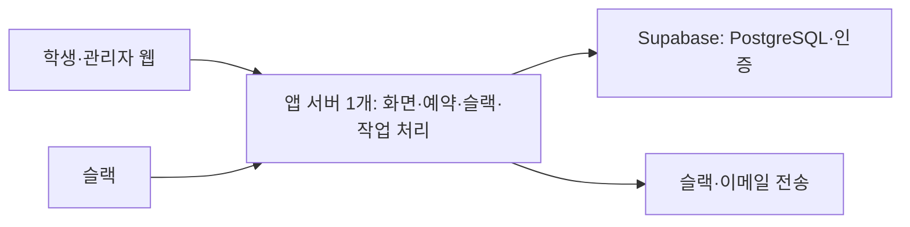

# 회의실 예약 시스템 경량화 검토

작성일: 2026-09-22

대상: [구현계획 v1](./회의실-예약시스템-구현계획-v1.md)

## 1. 결론

**가볍게 만들 수 있다. 첫 버전은 상시 실행 앱 서버 1개와 Supabase의 DB·인증으로 구성하고, 별도 작업 서버를 없애는 안을 권장한다.** 웹 예약·슬랙 예약·공정성 규칙·관리자 기능은 유지한다.

이전 계획은 200명·회의실 5개의 첫 도입에 비해 배포 단위와 데이터 구조를 세분화했다. 실제 코드나 측정 결과는 없으므로 '앱이 느리다'는 진단은 아니다. 이번 경량화의 주효과는 배포·운영과 구현 복잡도 감소다. 메모리·응답속도 개선 폭은 구현 후 측정해야 한다.

이 문서는 검토 결과와 권장 변경안이다. 기존 운영 정책을 교체하거나 서비스를 수정하지 않았다. 아래의 기능 유지안과 선택적인 범위 축소안을 구분한다.

## 2. 기능을 유지하는 경량 구성

Next.js·TypeScript·PostgreSQL·Supabase Auth는 유지한다. 이미 적합한 도구를 다른 프레임워크로 바꾸는 작업부터 시작하지 않는다. 이메일 인증용 SMTP도 여전히 필요하다. 외부 인증·메일·슬랙 서비스까지 하나의 서버로 사라지는 것은 아니다.

| 항목 | 기존 계획 | 경량 권장안 | 효과·조건 |
| --- | --- | --- | --- |
| 직접 배포하는 앱 | 웹 1개 + 작업 서버 1개 | 상시 실행 앱 1개 | 별도 작업 서버의 배포·설정·실행 비용 제거 |
| 예약 만료·알림 | 별도 워커 | 같은 서버의 짧은 작업 루프 | 서버 중단 시 함께 멈춤. DB 기록으로 재시작 후 재개 |
| 비동기 데이터 | 수신 작업·알림 의도·전송 결과 3개 테이블 | 유형과 상태가 있는 tasks 1개 | 발송 대상·채널별 행으로 관리 |
| 예약 부속 데이터 | 명단 스냅샷·방 점유·책임 이전을 분리 | 예약 행의 고정 명단·현재 이전 요청·중복 제약으로 통합 | 같은 사실을 여러 테이블에 동기화하는 코드 감소 |
| 기관 확장 구조 | 기관 관계를 모든 업무 데이터에 연결 | 설치당 기관 1개, 시설 설정 유지 | 다른 기관은 별도 설치. 다기관 가입 서비스는 만들지 않음 |

### 앱 안에서 작업을 실행할 때의 조건

상시 실행 Node 서버에서 초기화 훅으로 작업 루프를 시작한다. Next.js의 register는 새 서버 인스턴스 시작 시 호출되는 훅이다. 이를 작업 루프의 시작점으로 사용하는 것은 이 프로젝트의 설계 선택이며, Next.js가 내구성 있는 작업 실행을 보장하는 기능은 아니다. 개발·빌드·Edge 환경에서 잘못 실행되지 않게 실행 플래그와 Node 런타임 조건을 둔다. 무한 루프 완료를 기다려 서버 시작을 막지 않는다. [Next.js 초기화 훅](https://nextjs.org/docs/app/guides/instrumentation)

작업은 먼저 DB에 저장하고 처리한다. 메모리 타이머에는 다음 확인 시점만 맡긴다. 서버가 꺼져도 수락 요청·알림 자체는 없어지지 않는다. 슬랙 요청은 기존처럼 서명 검증과 작업 저장 후 신속히 접수 응답하고, 실제 성공 여부는 처리 후 알린다.

DB의 작업 점유 기한과 중복 키는 유지한다. 서버를 한 개만 설정해도 배포 중에는 이전·새 인스턴스가 겹칠 수 있기 때문이다. 이전 프로세스가 종료되면 기한이 지난 작업을 새 프로세스가 다시 가져간다. [Render 배포 수명주기](https://render.com/docs/deploys#zero-downtime-deploys)

외부 전송은 동시 실행 수와 timeout을 제한하고, DB 트랜잭션 밖에서 비동기로 실행한다. 느린 이메일 한 건 때문에 예약 요청과 시간 경계 정리가 줄줄이 대기하지 않게 한다. 재시도·최종 실패 기록은 남기되 범용 작업 관리 프레임워크를 따로 만들지 않는다.

`ponytail: 웹과 작업 루프가 같은 프로세스를 공유한다. 작업 부하로 예약 응답 목표를 충족하지 못하거나 독립적인 장애 격리가 필요해질 때 기존 작업 코드를 별도 워커로 옮긴다.`

이 구성은 유휴 시 중단되는 호스팅이나 요청 수명에 종속되는 서버리스 함수에는 그대로 적용하지 않는다. 앱 서버 장애 동안 웹·슬랙 처리가 함께 멈추는 점은 감수한다. 운영 기본안의 백업·복구 목표는 유지한다.

## 3. 데이터 구조를 줄이는 방법

기존 계획에서 표에 명명한 업무 테이블은 약 22개다. Auth 서비스 내부 테이블을 제외하고, 다음 통합을 적용하면 **14개 정도로 설계할 수 있다.** 실제 SQL 작성 전의 설계 수치이며 테이블 수 감소 자체가 성능 향상을 뜻하지 않는다.

| 통합 대상 | 경량 구현 | 유지할 조건 |
| --- | --- | --- |
| organizations + opening_rules | settings 한 행, 요일 운영시간은 정책 버전 안의 구조화된 값 | 방·시간 설정 가능, 날짜 예외는 별도 유지 |
| roster_snapshots + roster_snapshot_members | reservations의 first_confirmed_member_ids·start_member_ids | UUID 배열로 저장, 중복 제거, 각 시점 한 번만 기록, 보존기간 삭제 대상 포함 |
| room_claims | reservations에 유효 상태 조건이 붙은 시간 범위 배제 제약 | 모집중·확정·보충중의 같은 방 시간 겹침 차단 |
| responsibility_transfers + account_links | 예약에 현재 이전 요청 필드, 학생에 단일 Slack 연결 필드 | 이전 상대·만료·요청 ID 확인, 과거 변경은 감사 이력에 저장, Slack 연결 중복 방지 |
| integration_jobs + notification_outbox + notification_deliveries | tasks의 작업 유형·수신자·채널·시도 횟수·다음 실행·점유 기한·결과 | 예약과 알림 작업의 동시 커밋, 동일 업무 중복 실행 방지 |

유지하는 테이블은 settings, cohorts, members, rooms, policy_versions, opening_exceptions, reservations, reservation_members, member_claims, reports, sanctions, audit_events, command_receipts, tasks다.

개인 동시간대 중복을 DB에서도 막기 위한 member_claims는 유지한다. 예약 상태는 다른 테이블인데 개인 점유를 무리하게 참가자 행 안에만 넣으면 시간·취소 상태를 복제 관리하는 코드가 늘 수 있기 때문이다. 정책 적용일과 과거 예약 보존에 필요한 policy_versions도 유지한다.

방 중복 제약에는 현재시각을 조건으로 넣지 않는다. 기한이 지난 모집중 예약은 모든 변경 요청 처리 앞에서 CANCELLED로 바꾸고, 시작·종료 경계도 기존 규칙으로 정리한다. 읽기 화면은 유효 기한을 반영해 표시한다. 작업 루프가 잠시 늦어도 수락을 뒤늦게 허용하거나 만료된 예약이 새 신청을 계속 막으면 안 된다. PostgreSQL의 배제 제약은 범위 중복 방지에 사용할 수 있다. [PostgreSQL 제약](https://www.postgresql.org/docs/current/ddl-constraints.html#DDL-CONSTRAINTS-EXCLUSION)

기관 잠금은 settings의 한 행 잠금으로 바꾼다. 방별로 따로 검증해 서로 다른 방의 같은 모임 예약이 동시에 통과하는 문제를 만들지 않는다. 단일 설치의 쓰기 순서 보장은 현재 규모의 단순한 구현 선택이며, 처리량은 실제 시험한다.

## 4. 가볍게 만들더라도 유지할 것

1. **예약 트랜잭션과 중복 제약:** 시간 변경 실패 시 원래 예약 유지, 동시에 한 자리만 확정.
2. **기한·명단 규칙:** 최초 모집과 인원 보충 기한 구분, 과거 판정 명단 보존, 시작 이후 행동 제한.
3. **권한과 인증:** 등록 학생 확인, 관리자 분리, Slack 서명 검증, 비공개 명단 보호.
4. **재시도에 대한 안전성:** 버튼 재실행·네트워크 재전송·배포 중 작업 재개가 예약을 중복 생성하지 않음.
5. **필수 검증과 복구:** 실제 DB 동시성 시험, 핵심 브라우저 흐름, 백업 복원 시험.

테스트 도구를 없애는 것보다 시험 범위를 위험한 기능에 집중한다. 실제 출석을 측정하지 않는 정책도 유지한다. Redis·웹소켓·다기관 공개 가입은 원래 계획에도 없었으므로 새로 제거한 성과로 계산하지 않는다.

## 5. 더 크게 줄이는 선택안 — 운영 범위 변경 필요

| 선택안 | 줄어드는 작업 | 달라지는 경험·조건 | 이번 검토의 판단 |
| --- | --- | --- | --- |
| 슬랙은 알림과 웹 열기만 제공 | 슬랙 전용 신청 모달·구성원 선택·수락 화면·비동기 결과 안내 | 예약과 응답을 웹에서 수행. 기존 슬랙 내 완료 목표 축소 | 개발량을 더 줄이고 싶을 때 가장 먼저 검토. 자동 채택하지 않음 |
| 3초 갱신을 15초로 완화 | 열어 둔 화면의 반복 조회량 감소 | 다른 사람의 변경 표시가 늦어짐. 5초 반영 목표 변경 | 서버 부하 측정 전에는 유지 |
| 동일 모임 판정을 더 단순하게 변경 | 명단 시점·추가 수락·이탈 예외 처리 감소 | 다른 모임 참여를 막거나 우회가 쉬워질 수 있음 | 핵심 정책이므로 이번 경량화 대상에서 제외 |
| 복구 목표를 완화해 일일 백업만 사용 | 관리형 DB의 촘촘한 복구 옵션 비용 감소 가능 | 최대 1시간 데이터 손실 목표를 충족하지 못함 | 기관이 손실 허용 범위를 바꾸기 전에는 유지 |

화면을 계속 열어 둔 100명이 3초마다 조회하면 단순 계산상 분당 약 2,000회, 15초마다 조회하면 약 400회다. 이는 요청 수 계산이며 실측 부하가 아니다. 탭 비활성 시 중지·변경 직후 조회는 두 안 모두 적용한다.

기존 계획의 복잡성 상당 부분은 프레임워크보다 '초대 수락·인원 보충·명단별 공정성·슬랙에서 모든 흐름 완료'에서 나온다. 서버를 합친다고 이 규칙 구현이 없어지지는 않는다. 같은 기능을 유지하면서 개발 기간을 절반으로 줄인다고 예상하지 않는다.

백업 비용도 서버 한 개를 줄이는 것과 별개다. Supabase의 일일 백업과 PITR은 복구 가능한 시점이 다르며, 기존 복구 목표를 유지하려면 그에 맞는 백업을 선택해야 한다. [Supabase 백업 설명](https://supabase.com/docs/guides/platform/backups)

## 6. 권장 실행 순서

기능 유지형 경량안을 권장한다. 운영기획은 유지하고 앱 배포를 하나로 합치며, 데이터 구조의 중복만 줄인다. v1의 마감 판정시각·관리자 시작 후 수정 범위 보완안은 여전히 별도의 명세 보완 사항이며 경량화가 이를 새로 확정하는 것은 아니다.

1. **상시 서버와 작업 루프 검증:** 실제 배포 환경에서 DB 작업 저장 → 서버 재시작 → 재개를 확인한다. 예상 0.5~1작업일이며 기존 기반 구축 단계에 포함한다.
2. **경량 스키마로 핵심 흐름 구현:** 신청 → 수락 → 확정 → 충돌 거절을 만들고 기한 경합·실패한 시간 변경을 확인한다.
3. **같은 서버에 웹·슬랙 연결:** 기존 정책을 공통 코드로 실행하고 외부 알림 지연·중복 전달 상황을 시험한다.
4. **100명 조건으로 측정:** p95 응답·갱신 지연·작업 지연·메모리 사용을 기록한다. 목표 미달 원인을 확인한 경우에만 작업 서버를 분리한다.

배포 단위는 앱 2개에서 1개로 줄어든다. 관리형 DB·인증과 SMTP는 유지한다. 개발 일정은 우선 기존 21~30작업일 범위를 유지하고, 첫 단계에서 재추정한다. 근거 없는 기간·비용 절감률은 제시하지 않는다.

**다음 작업: 경량 스키마와 단일 서버의 작업 재개를 먼저 검증하고, 이를 이후 구현 기준으로 구체화한다.**
