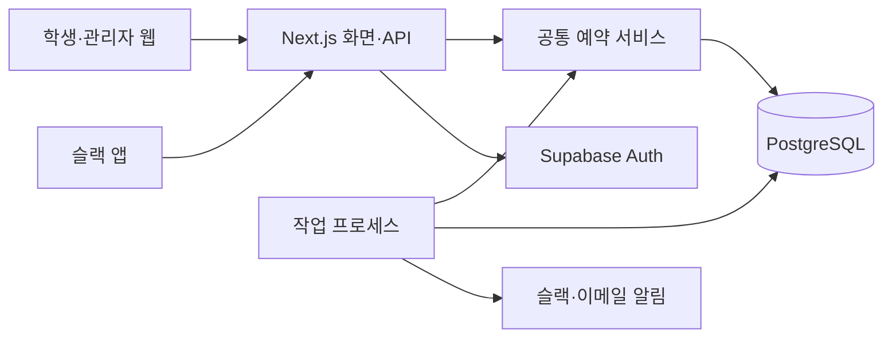
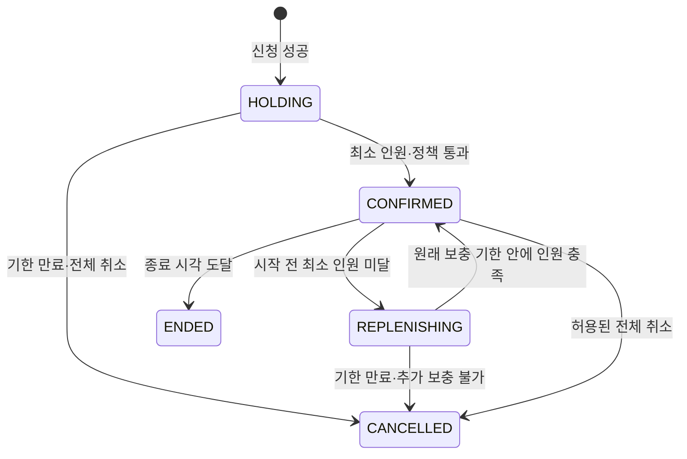

# 회의실 예약 시스템 구현계획 v1

작성일: 2026-09-22

기준 문서: [운영기획안 v1](./회의실-예약시스템-운영기획안-v1.md)

## 1. 구현 방향

**Next.js와 TypeScript로 웹·서버를 한 저장소에서 개발하고, PostgreSQL에서 예약의 정합성을 보장한다. 웹과 슬랙은 같은 예약 서비스를 호출하며, 만료 처리와 외부 알림은 별도 작업 프로세스가 담당한다.**

첫 배포는 한 기관·5개 회의실·전체 이용자 200명을 기준으로 한다. 웹 서버 1개, 작업 프로세스 1개, 관리형 데이터베이스 1개로 시작한다. 기능별 독립 서버, 별도 캐시 서버, 메시지 브로커는 초기 구성에 넣지 않는다. 규모 확대는 부하검사 결과를 보고 결정한다.

이 문서는 구현 설계와 작업 계획이다. 서비스 코드 작성·계정 개설·유료 서비스 구매·배포는 수행하지 않았다. 기존 작업 폴더에는 운영기획 문서만 있으므로 기존 코드나 기술 스택에 맞춰야 하는 제약은 확인되지 않았다. 팀의 특정 언어 경험과 예산 조건이 없다는 가정으로 권장안을 선택했다.

## 2. 권장 기술과 운영 구성

| 영역 | 선택 | 선택 이유와 적용 범위 |
| --- | --- | --- |
| 웹과 API | Next.js App Router + React + TypeScript | 학생·관리자 화면과 서버 API를 한 프로젝트에서 개발 |
| UI | Tailwind CSS, 필요한 접근성 컴포넌트만 도입 | 시간표는 서비스에 맞게 직접 구현하고 폼·대화상자 등은 검증된 컴포넌트 사용 |
| 데이터베이스 | Supabase 관리형 PostgreSQL | 관계형 데이터, 트랜잭션, 시간 구간 중복 제약 활용 |
| DB 접근 | node-postgres의 pg + 버전 관리한 SQL 마이그레이션 | 잠금·범위 제약·트랜잭션을 명시적으로 구현. SQL 매개변수 바인딩 사용 |
| 로그인 | Supabase Auth 이메일 OTP | 등록된 학생이 이메일 코드로 로그인. 비밀번호 직접 운영 부담 축소 |
| 웹 배포 | Render 상시 실행 Web Service | 서버 API와 슬랙 콜백 수신 |
| 작업 실행 | 같은 저장소의 Render Background Worker | 만료·시작 스냅샷·알림·슬랙 요청 후속 처리 |
| 자동 검증 | Vitest + 실제 PostgreSQL 통합검사 + Playwright | 정책 계산, 경합, 학생·관리자 화면 흐름을 다른 수준에서 검증 |

버전은 개발 착수 시 호환되는 안정 버전으로 고정하고 lockfile을 저장한다. 운영과 테스트의 PostgreSQL 주 버전을 맞추고 btree_gist 확장 사용 가능 여부를 첫 DB 연결 검증에서 확인한다.

Next.js는 Node.js 서버로 배포할 수 있다. 이 구조에서는 서버 기능을 사용하는 정규 배포를 선택한다. [Next.js 배포 문서](https://nextjs.org/docs/app/getting-started/deploying)

상시 실행 워커는 Render가 제공하는 별도 서비스 유형을 사용한다. 워커도 같은 코드와 DB를 사용하고, 도메인별 독립 서버로 만들지는 않는다. [Render Background Workers](https://render.com/docs/background-workers)

### 구성도



공통 예약 서비스는 웹 프로세스와 워커가 함께 불러 쓰는 TypeScript 코드다. 독립적으로 배포하는 서버가 아니다.

## 3. 코드 구조와 책임

```text
src/
  app/                    학생·관리자 화면, API 진입점
  server/
    booking/              신청·수락·변경·취소·책임 이전 처리
    policy/               시간·정원·구성원 중복·권한 판정 함수
    admin/                학생·운영 설정·신고·제재 처리
    integrations/         Supabase 인증, Slack, 이메일 연결
    db/                   연결, 트랜잭션, 기능별 SQL
  worker/                 만료·시작·종료 처리와 알림 작업
  ui/                     시간표·예약 폼·상태 표시
db/
  migrations/             순서가 있는 SQL 변경 파일
  seeds/                  개발용 시설·학생·예약 데이터
tests/
  policy/                 정책 경계값
  integration/            실제 DB 동시성·롤백·작업 재실행
  e2e/                    브라우저 사용자 흐름
```

화면은 입력을 수집하고 결과를 표시한다. 정책 함수는 받은 명단·시간·설정에 대한 판단만 반환한다. 예약 서비스가 DB에서 최신 정보를 읽고 정책을 적용한 뒤 한 번에 저장한다. 슬랙 연결 코드는 슬랙 입력을 같은 명령으로 변환한다.

실제 구현에서 HTTP 핸들러나 React 컴포넌트에 공정성 공식을 복제하지 않는다. UI의 사전 안내는 편의를 위한 것이며 최종 허용 여부는 서버가 판단한다.

## 4. 데이터 모델

### 사용자·시설·설정

| 테이블 | 주요 데이터 | 제약·역할 |
| --- | --- | --- |
| organizations | 이름, 시간대, 운영 상태 | 한 기관으로 시작. 모든 업무 데이터의 소속을 검증 |
| cohorts | 기관, 기수 이름, 시작·종료일 | 기수 종료와 보존 기간의 기준 |
| members | 인증 계정 ID, 기관·기수, 이메일, 표시 이름, 역할, 활성 상태, 신청 제한 종료 | 기관 내 이메일 중복 방지. 신청 제한과 계정 비활성화를 구분 |
| rooms | 기관, 이름, 활성 여부 | 삭제 대신 비활성화, 과거 예약 참조 유지 |
| policy_versions | 기관, 적용일, 정책값, 방별 정원·최소 인원 설정 | 적용일 이후의 불변 정책 묶음. 저장 후 수정은 새 버전 생성 |
| opening_rules / opening_exceptions | 요일 시간표, 날짜·방별 개방·휴관 | 전체 휴관이 방별 개방보다 우선 |

과거 예약은 적용한 policy_version_id와 방 정원·최소 인원 값을 보존한다. 화면에 현재 방 정원을 그대로 가져와 과거 예약의 판정이 바뀌지 않도록 한다. 새 정책 적용일로 예약을 옮기면 새 버전으로 전체 검증한다.

### 예약과 점유

| 테이블 | 주요 데이터 | 제약·역할 |
| --- | --- | --- |
| reservations | 기관, 방, 최초 신청자, 현재 책임자, 시작·종료, 상태, 최초 확정 시각, 최초 확보 기한, 보충 기한, 버전 | 하나의 예약을 대표하는 레코드 |
| reservation_members | 예약, 학생, 초대한 사람, 응답 상태, 응답 시각, 초대 세대 번호 | 예약·학생 조합 하나. 재초대 시 세대 증가로 이전 버튼 무효화 |
| roster_snapshots / roster_snapshot_members | 예약, FIRST_CONFIRMED 또는 AT_START, 학생 목록 | 첫 확정·시작 순간의 명단을 각각 한 번만 생성 |
| room_claims | 예약, 기관, 방, 시간 범위 | 현재 유효한 공간 점유만 보관. 같은 방 시간 겹침을 DB에서 거절 |
| member_claims | 예약, 기관, 학생, 시간 범위 | 신청자·수락자의 개인 일정 점유. 대기 초대는 만들지 않음 |
| responsibility_transfers | 예약, 기존·새 책임자, 상태, 만료 | 한 예약에 유효한 이전 요청 한 건 |

reservations는 이력을 남기고, claims는 현재의 유효 점유를 나타낸다. 최초 모집중·보충중에도 공간을 점유한다. 취소·기한 만료·종료 시 claims를 제거한다. 참여 취소 시 해당 member_claim만 제거한다. 기준 명단의 과거 참여자는 개인 일정을 계속 점유하지 않는다.

모든 시간은 timestamptz로 저장한다. 사용자에게 보여줄 날짜와 운영시간 계산에는 기관 시간대를 적용한다. 시간 구간은 `[시작, 종료)`로 표현하고 시작이 종료보다 앞서야 한다.

### 운영과 비동기 작업

| 테이블 | 역할 |
| --- | --- |
| reports / sanctions | 신고 접수·처리와 기간이 있는 이용 제한 |
| audit_events | 행위자, 대상, 변경 전후 요약, 사유, 서버 판정시각 |
| command_receipts | 중복 요청 키, 요청 내용 해시, 처리 상태, 최소 결과. 같은 요청 재시도 시 중복 실행 방지 |
| integration_jobs | 수신한 슬랙 명령, 계정 초대 등 비동기 작업과 재시도·점유 기한 |
| notification_outbox / notification_deliveries | 예약 변경과 함께 저장되는 알림 의도, 수신자·채널별 전달 결과 |
| account_links | 학생과 Slack workspace_id·user_id 연결. 양쪽 중복 연결 방지 |

기관 ID가 있는 테이블 사이의 참조는 기관 일치도 함께 검증한다. API마다 기관을 브라우저 입력에서 신뢰하지 않고 인증된 소속에서 결정한다. 인덱스는 예약의 기관·시작일, 구성원의 학생·상태, 미처리 작업의 다음 실행시각에 우선 둔다.

## 5. 예약 상태와 전이

DB 예약 상태는 HOLDING, CONFIRMED, REPLENISHING, CANCELLED, ENDED 다섯 가지다. 시작 이후부터 종료 이전까지의 '이용 시간 도래'는 CONFIRMED와 서버 시간으로 계산한다. 출석 상태를 저장하지 않는다.



최소 인원 미달 예약은 시작 시각에 확정 예약으로 취급하지 않는다. 시작 시각에 남아 있는 대기 초대와 책임 이전 요청을 만료시키고, 확정된 예약의 수락 명단을 AT_START로 고정한다.

시작 처리가 지연되어도 모든 명령은 먼저 시간 경계를 정리한다. 예를 들어 관리자가 시작 직후 구성원을 제외하려 하면 먼저 AT_START를 저장한 뒤 관리자 조치를 기록한다. 워커가 늦었다는 이유로 시작 명단이 나중의 상태로 바뀌면 안 된다.

화면 상태 계산과 실제 저장 상태 변경은 같은 경계 규칙을 사용한다. 읽기 요청이 작업 지연 상태를 발견해도 이미 기한이 지난 예약을 유효하게 보여주지 않는다.

## 6. 동시 예약을 처리하는 방식

### 기관 단위의 짧은 쓰기 잠금

초기에는 예약을 변경하는 트랜잭션이 기관 레코드 한 행에 SELECT FOR UPDATE 잠금을 얻은 뒤 처리한다. 방별 잠금만으로는 서로 다른 방의 같은 모임 충돌을 막을 수 없기 때문이다. 신청·수락·취소·책임 이전·정책 변경·학생 비활성화·시간 경계 처리까지 이 규약을 공유한다. 시간표 조회는 이 잠금을 사용하지 않는다.

단일 기관의 쓰기를 순서대로 처리하는 단순한 설계다. 네트워크 통신이나 이메일 전송을 잠금 안에서 하지 않고 트랜잭션을 짧게 유지한다. 조회 100명과 동시 신청 100건을 실제로 시험한다. 응답 목표를 충족하지 못하면 병목 SQL과 네트워크 왕복을 먼저 줄인다. 그래도 부족할 때 날짜·구성원별 잠금으로 세분화한다. 현재 규모에서 빠를 것이라는 가정만으로 성능을 합격 처리하지 않는다. [PostgreSQL 행 잠금](https://www.postgresql.org/docs/current/explicit-locking.html)

### 한 번의 변경 처리

1. 인증·입력 형식을 확인하고 같은 DB 연결로 트랜잭션을 시작한다. 기관 잠금을 획득한다.
2. 실제 DB 현재시각을 읽고 만료·시작·종료 경계를 정리한다. 변경 요청의 중복 키와 현재 예약 버전을 확인한다.
3. 최신 회원 상태·권한·운영시간·정원·개인 일정·모임 간격을 검사하고 변경 가능한 결과를 계산한다.
4. 예약·참여자·스냅샷·점유·감사 이력·알림 의도를 함께 저장하고 커밋한다. 거절 결과인 경우 요청 변경은 저장하지 않는다.
5. 웹에 결과를 반환한다. 워커는 커밋된 알림만 외부로 전송한다.

검증 실패가 그 전에 수행한 정상적인 기한 만료까지 되돌리지 않도록 경계 정리 이후 저장점을 둔다. 업무상 거절은 정리 결과와 거절 영수증을 커밋하고 반환한다. DB 장애처럼 상태를 신뢰할 수 없는 실패는 전체 롤백한다. DB 제약 오류는 저장점으로 되돌린 뒤 사용자에게 충돌 결과를 반환한다.

DB의 now()는 트랜잭션 시작시각으로 고정될 수 있으므로 잠금 대기 후 마감 판단에는 clock_timestamp()로 확보한 판정시각을 사용한다. 한 명령의 검증에는 그 값을 일관되게 사용하고 긴 트랜잭션에는 시간 제한을 둔다.

같은 트랜잭션의 SQL은 반드시 같은 pg client에서 실행한다. [node-postgres 트랜잭션 문서](https://node-postgres.com/features/transactions)

### DB의 마지막 방어선

room_claims에는 기관·방이 같으면서 tstzrange가 겹치는 행을 허용하지 않는 GiST exclusion constraint를 둔다. member_claims에도 기관·학생 기준의 동일한 제약을 둔다. 시간 제약은 애플리케이션 검사가 누락되어도 중복 저장을 거절하기 위한 장치다. 정원과 모임 판정은 기관 잠금 안의 공통 서비스에서 검사한다. [PostgreSQL 범위·배제 제약](https://www.postgresql.org/docs/current/rangetypes.html#RANGETYPES-CONSTRAINT)

제약 조건에 '현재 시각 이전이면 자동 무효' 같은 동적 식을 넣지 않는다. 만료된 점유 행은 명령 처리나 워커가 명시적으로 지운다. 예약 이동은 기존 점유 수정과 새 조건 검증을 같은 트랜잭션에서 수행하므로 실패하면 원래 방·시간이 유지된다.

## 7. 정책 구현의 세부 기준

### 공정성 판정

policy 모듈은 기준 문서의 명단 규칙을 구현한다. 최초 확정 후보는 새 명단 하나, 추가 수락 후보는 수락 후 전체 명단, 시간 변경 후보는 기준 명단과 최소 인원을 충족한 현재 명단이다. 상대 예약은 시작 전이면 기준·유효 현재 명단, 시작 후이면 기준·AT_START 명단을 제공한다. 후보와 상대의 명단 조합 중 하나라도 중복 기준을 초과하면 같은 모임이다.

본인 이탈은 기존 확정 예약을 소급 취소하지 않는 예외를 그대로 구현한다. 참가자 축소와 새 수락을 같은 변경으로 취급하지 않는다. 반복 확정 시 FIRST_CONFIRMED 명단을 덮어쓰지 않는다.

비율은 부동소수점 나눗셈 대신 정수 비교로 판정한다. 설정 비율을 basis points로 저장하면 `공통인원 × 10000 > 작은명단인원 × 기준값`으로 계산한다. 최소 인원을 충족하지 못한 현재 명단과 자기 예약은 비교에서 제외한다. 시간 후보를 먼저 걸러 전체 기록을 매번 비교하지 않는다.

### 기한·신청 제한

최초 확보 기한과 최초 보충 기한을 별도로 저장한다. 보충 완료 후에도 첫 보충 기한을 남겨 두고, 다시 미달이 되면 새 10분을 부여하지 않는다. 시간 이동으로도 기한을 연장하지 않는다. 기한 만료 후 신규 신청 제한은 '워커가 발견한 시각'이 아니라 '원래 만료 시각 + 10분'을 기준으로 한다.

책임 이전으로 제한을 우회하지 않도록 최초 신청자 ID는 불변이다. 모집중·보충중 동시 1건은 최초 신청자 기준으로 검사하고, 책임 이전 시에는 새 책임자의 모집중·보충중 관리 건수도 확인한다. 서로 다른 계정을 새로 등록해 같은 학생을 중복 표현하지 않도록 계정 정정은 관리자 절차로 처리한다.

### 구현에 필요한 두 가지 문구 명확화

운영안의 '서버에 도착한 시각'은 **예약 처리 잠금을 획득하고 DB에서 판정하는 시각**으로 구체화하는 것을 권장한다. 웹 요청 수신 또는 슬랙 접수는 성공 보장이 아니다. 잠금 대기 중 기한이 지나면 만료로 응답한다. 전송 시각 우선권을 보장하려면 모든 요청과 만료 작업을 하나의 순서 큐로 처리하는 추가 설계가 필요하므로 첫 버전에서는 채택하지 않는다. 원래 운영안의 문구를 변경 없이 구현했다고 주장하지 않는다.

관리자의 시작 후 시간 변경은 운영안에 상세 범위가 없으므로, 첫 버전은 시작된 예약의 취소·사유 기록·구성원 정정만 제공하고 과거 시간 자체를 다시 쓰는 기능은 제공하지 않는 안을 권장한다. 시작 전 예약 이동은 기본 검증을 통과해야 한다. 이 두 항목은 화면·도움말 및 인수 기준에도 같은 문구로 반영할 기술 명세 보완안이다.

## 8. API와 오류 계약

| 기능 묶음 | API 예시 | 주요 결과 |
| --- | --- | --- |
| 조회 | GET /api/schedule, /api/me/reservations, /api/me/invitations | 역할에 맞게 제한한 최신 상태와 서버 시각 |
| 신청·변경·취소 | POST /api/reservations, /:id/change, /:id/cancel | 확정된 저장 결과 또는 구체적인 실패 사유 |
| 구성원·책임 이전 | POST /:id/invitations, /invitations/:id/accept, /decline, /:id/leave, /:id/transfers | 해당 행동의 결과, 갱신된 예약 버전 |
| 관리자 | /api/admin/members, /policies, /closures, /reports, /sanctions | 사전 영향 조회와 명시적 실행을 구분 |
| 외부 연동 | /api/integrations/slack/interactions, /commands, /link | 검증된 외부 입력의 접수·처리 상태 |

자원 URL은 구현 시 API 명세에서 전체 경로를 확정한다. 범용적인 예약 전체 덮어쓰기 API 대신 행동별 명령을 둔다. 학생이 요청 본문의 role, actor_id, organizer_id를 바꿔 권한을 얻을 수 없도록 한다.

변경 요청에는 Idempotency-Key를 사용하고, 같은 키에 다른 내용이 들어오면 거절한다. 갱신·취소 등 오래된 화면에서 실행하면 의도와 달라질 수 있는 요청에는 expectedVersion을 보낸다. 초대 응답은 초대 ID·수신자·세대 번호를 확인하고, 다른 사람이 수락해 예약 버전이 올랐다는 이유만으로 무조건 거절하지 않는다. 이때도 최신 조건은 다시 검사한다.

| 오류 코드 | 학생 안내 | 다음 행동 |
| --- | --- | --- |
| ROOM_UNAVAILABLE | 다른 예약이 먼저 확보했습니다 | 시간표 새로고침 |
| INVITATION_EXPIRED | 초대 또는 모집 기한이 지났습니다 | 최신 예약 확인 |
| MEMBER_TIME_CONFLICT | 참여 중인 예약과 시간이 겹칩니다 | 본인 예약 확인 |
| GROUP_GAP_REQUIRED | 같은 모임의 이용 간격이 부족합니다 | 가능한 시간대로 변경 |
| CAPACITY_REACHED | 대기 초대를 포함해 정원이 찼습니다 | 대기 초대 정리 |
| BOOKING_COOLDOWN | 새 신청 제한 시간이 남아 있습니다 | 서버가 반환한 해제시각 확인 |
| STALE_VERSION | 다른 변경이 먼저 반영됐습니다 | 최신 내용 확인 후 다시 실행 |
| SERVICE_BUSY | 요청이 많아 처리하지 못했습니다 | 같은 요청 키로 재시도 |

응답에는 code, message, serverTime, reservationVersion, 필요한 경우 retryAt을 담는다. 실패한 모임 판정에서 다른 모임의 비공개 참여자 명단을 반환하지 않는다. 예약 성공 여부를 모르는 네트워크 단절에는 새 예약을 생성하지 않고 기존 요청 키로 결과를 확인한다.

## 9. 웹 화면 구현

학생 화면은 로그인, 시간표, 신청 폼, 예약 상세, 내 예약·초대, 신고로 구성한다. 관리자 화면은 당일 현황, 학생 관리, 시설·운영 설정, 신고·제재 이력으로 묶는다.

시간표는 서버에서 계산한 실제 운영 구간을 사용한다. 5개 방이나 평일 18시를 UI 코드에 고정하지 않는다. 데스크톱은 시간축을 맞춘 방별 열, 모바일은 날짜 선택과 방별 세로 목록으로 구현한다. 선택 동작은 클릭·키보드로 가능하게 하고 드래그를 필수로 만들지 않는다.

빈 구간을 선택하면 방·시간이 채워진 폼이 열리고, 길이와 구성원만 고르게 한다. 상세에는 '수락 2명 / 대기 1명 / 정원 4명'처럼 분리해 표시한다. 버튼은 서버가 반환한 허용 행동에 따라 노출하되 실행 시 권한을 다시 확인한다.

최초 화면에서 데이터 한 번을 받고 활성 탭에서는 3초 간격으로 갱신한다. 숨긴 탭은 갱신을 멈추고 다시 열면 즉시 조회한다. 자신의 변경 직후에도 즉시 다시 읽는다. 네트워크 지연과 조회 시간을 포함해 기존 5초 반영 목표를 시험한다. 목표 미달이면 서버 전송 이벤트를 검토한다. 처음부터 웹소켓 기반 상태 동기화를 도입하지 않는다.

시간표·초대 같은 개인화 데이터에는 공유 캐시를 적용하지 않는다. 화면이 오래되면 마지막 확인 시각을 표시하고 제출 시 최종 검증한다. 예약 성공은 서버 응답 전까지 확정으로 표시하지 않는다. 카운트다운은 서버 시각 차이를 보정하지만, 종료 여부는 서버 판정을 따른다.

## 10. 로그인·명단 등록·권한

관리자가 CSV를 올리면 이름·이메일·기수·반을 검증한 미리보기를 보여준다. 중복·잘못된 이메일은 행 단위로 표시하고, 확정한 유효 행만 등록한다. 반복 업로드가 계정·초대를 중복 생성하지 않게 한다.

Supabase Auth의 이메일 OTP를 사용하고 임의 신규 가입을 막는다. 관리자가 등록·초대한 계정만 로그인할 수 있게 하며 인증 이후에도 매 요청마다 내부 회원의 활성 상태와 역할을 확인한다. OTP 요청의 shouldCreateUser 옵션은 false로 두고 공개 가입 설정도 제한한다. [Supabase 이메일 인증](https://supabase.com/docs/guides/auth/auth-email-passwordless)

기관 메일 주소나 SMTP 제공자를 연결해 로그인 메일을 보낸다. Supabase 기본 SMTP는 운영용 발송을 전제로 하지 않으므로 실제 학생을 받는 출시 전에 별도 SMTP 연결과 이메일 도달 시험을 완료한다. [Supabase SMTP 제약](https://supabase.com/docs/guides/auth/auth-smtp)

Auth 계정 생성과 내부 DB 갱신은 단일 트랜잭션으로 묶을 수 없으므로 등록 작업을 pending → provisioning → active/failed로 추적하고 재시도 가능하게 만든다. 인증 계정만 생성되고 내부 회원이 활성화되지 않았으면 예약 접근을 허용하지 않는다.

업무 테이블은 공개 Data API에서 접근할 수 없는 전용 스키마에 두고 브라우저의 DB 직접 쓰기를 허용하지 않는다. 서버의 DB 역할은 필요한 업무 테이블만 수정하고 마이그레이션 권한과 분리한다. 인증 관리자 키, DB 비밀번호, Slack signing secret은 서버 비밀 설정으로만 보관한다.

세션은 공식 서버 인증 통합에 맞게 검증하고, 상태 변경 API에서 Origin·CSRF 방어를 적용한다. 초대 코드·인증 코드·외부 토큰·원문 명단을 일반 로그에 출력하지 않는다. 학생 비활성화는 기존 세션이 남아 있어도 즉시 업무 API에서 차단한다.

## 11. 슬랙과 알림 작업

슬랙 구현 순서는 계정 연결과 알림, 수락·거절 버튼, 조회·신청 모달, 내 예약 조회다. 웹의 필수 기능이 완성된 뒤 같은 예약 서비스를 연결한다. 첫 출시 목표의 조회·신청·초대·수락·거절·상태 확인을 모두 포함하며 관리자 기능은 웹에서 제공한다.

계정 연결은 로그인한 웹에서 발급한 짧은 유효기간의 일회용 코드를 학생이 슬랙 앱에 입력하는 방식으로 시작한다. 웹 세션의 학생과 서명 검증된 Slack workspace_id·user_id를 연결한다. 코드 만료·시도 횟수 제한·한 번만 사용·기존 연결 충돌 검사를 적용한다. 표시 이름으로 연결하지 않는다.

슬랙 요청은 raw body 기준 서명과 timestamp를 검증한 뒤 허용된 워크스페이스인지 검사한다. 연결된 학생의 최신 활성 상태도 확인한다. Slack 공식 문서는 서명 검증과 재전송 공격을 줄이기 위한 시각 검사를 안내한다. [Slack 요청 검증](https://docs.slack.dev/authentication/verifying-requests-from-slack/)

슬랙 인터랙션은 3초 이내 응답해야 한다. 서명 검증과 내구성 있는 작업 저장을 빠르게 완료한 뒤 접수를 응답하고, 워커가 공통 서비스를 실행해 결과를 개인 메시지나 기존 메시지 갱신으로 알린다. 접수는 예약 성공이 아니다. 모달을 여는 동작은 trigger_id 유효시간을 고려해 즉시 처리하며 장기 큐로 보내지 않는다. [Slack 인터랙션 응답](https://docs.slack.dev/interactivity/handling-user-interaction/)

슬랙 모달 제출은 기본 입력 오류를 즉시 표시하고, 최종 방 선점·공정성 판정은 공통 서비스의 결과로 안내한다. 느린 요청을 서버 메모리의 떠 있는 Promise에만 맡기지 않는다. 작업 저장이 실패했으면 접수 성공으로 응답하지 않는다.

알림은 예약 트랜잭션에서 outbox에 저장하고 워커가 전송한다. 수신자·채널·예약 이벤트 버전별 중복 발송 키를 사용한다. 시작값으로 1분·5분·15분 간격의 재시도를 두되 외부 서비스의 Retry-After를 우선하고, 마지막 실패는 관리자에게 표시한다. 오래된 초대·변경 알림은 현재 상태를 확인해 생략하거나 최신 상태로 대체한다.

외부 API가 발송에 성공한 직후 서버가 끊기면 중복 전송 가능성이 남는다. 내부 예약은 한 번만 변경하고 외부 알림은 중복을 최소화하는 방식이며, 외부 전달까지 완전한 1회 전송을 보장한다고 표현하지 않는다.

워커는 만료 작업을 약 1초 간격으로 확인하고, 외부 전송에는 동시 실행 수와 timeout을 둔다. 느린 슬랙 호출이 만료 처리를 막지 않도록 DB 작업과 외부 전송을 분리한다. 작업은 lease와 재시도 시각을 저장하며 워커 재시작 시 만료된 lease를 회수한다. 여러 워커로 늘려도 같은 작업을 동시에 점유하지 않도록 처리한다.

## 12. 배포·운영·비용 계획

개발은 Windows의 Node 환경과 로컬 PostgreSQL 컨테이너를 기본으로 한다. Docker를 사용할 수 없으면 개발 전용 DB를 연결한다. 테스트 데이터는 가상 학생을 사용한다. 스테이징은 운영과 다른 DB·인증 설정·Slack 앱 또는 시험용 워크스페이스를 사용한다.

앱과 DB는 가능한 가까운 제공 지역을 선택해 지연을 줄인다. 서버 DB 연결은 검증된 direct 또는 session pooler 구성을 기본으로 하고 연결 수를 제한한다. transaction pooler로 변경할 경우 prepared statement·세션 상태 제한을 함께 검증한다. [Supabase DB 연결 방식](https://supabase.com/docs/guides/database/connecting-to-postgres)

배포 절차는 자동 검사 → 스테이징 마이그레이션 → 주요 흐름 확인 → 운영 마이그레이션 → 웹·워커 배포 → 상태 확인이다. 스키마는 이전 앱 버전과 공존할 수 있게 먼저 추가하고, 데이터 이전 후 필요 없는 구조를 나중에 제거한다. 앱 롤백이 데이터 삭제나 무조건적인 DB 역마이그레이션을 의미하지 않게 한다.

운영에서 확인할 지표는 예약 처리 p95, DB 잠금 대기, 오래된 미처리 알림, 워커 마지막 실행, 백업 복구 가능 시점이다. 기술 오류와 업무상 거절은 분리한다. 예를 들어 빈방 선점 실패를 서버 장애율에 넣지 않는다.

기존 운영안의 복구 목표는 최대 1시간의 데이터 손실과 운영 중 2시간 이내 복구다. 하루 한 번 백업만으로는 첫 목표를 충족하지 못하므로 운영 기본안은 PITR이 가능한 관리형 DB 구성을 사용하고 실제 복구 훈련을 수행하는 것이다. Supabase의 PITR은 별도 조건과 추가 비용이 있다. [Supabase 백업·PITR](https://supabase.com/docs/guides/platform/backups)

예산 항목은 상시 웹 1개, 워커 1개, 관리형 DB·Auth, PITR, 인증 메일, 도메인이다. 정확한 월액은 구매 시점의 지역·플랜·백업 옵션으로 견적한다. 이 계획에서 유료 계약은 하지 않는다. 특히 PITR이 기본 앱 실행 비용보다 클 수 있으므로, 예산 검토 때 백업비를 별도 줄로 확인한다. 예산 때문에 복구 목표를 바꾸려면 운영 기획 변경으로 명시해야 한다.

개인정보 삭제 작업은 예약 이력뿐 아니라 감사 로그·명령 영수증·작업 payload·계정 연결에도 적용한다. 영수증에는 최소 결과만 저장하고 기본 7일 후 정리한다. 삭제 대상 정보가 백업 복원으로 다시 나타나면 접근을 열기 전에 삭제 정책을 다시 적용한다. 기수 종료 후 90일 정책은 기관 확인 결과에 맞춰 설정한다.

DB 장애 시 앱은 예약을 성공한 것처럼 받지 않는다. 복구 전 수동 예약을 별도 운영한다면 담당자가 하나의 명단으로 관리하고, 서비스 재개 전 충돌을 정리한 뒤 반영한다.

## 13. 검증 계획과 출시 조건

| 검증 묶음 | 필수 시나리오 | 합격 조건 |
| --- | --- | --- |
| 정책 계산 | 50%와 초과, 59분과 60분 간격, 3일 창, 21:30 종료, 앞뒤 예약, 축소 예외, 정책 적용일 이동 | 기준 문서의 기대 결과와 일치 |
| 동시성 | 같은 방 100건 신청, 서로 다른 방의 같은 모임 동시 확정, 같은 학생의 동시 수락, 대기 정원 동시 초대 | 방·개인 중복과 정원 초과 0건, 허용되지 않은 이중 확정 0건 |
| 상태·복구 | 마감 경합, 원래 기한 유지, 두 번째 인원 미달, 늦은 워커, 시작 직후 관리자 변경, 실패한 이동, 요청·알림 재실행 | 명단·기한·원래 예약 보존, 중복 업무 처리 0건 |
| 권한·화면 | 학생의 타인 예약 수정, 초대 세대 변경, 미연결 Slack 사용자, 비활성 계정, 모바일 예약, 비공개 명단 노출 | 권한 없는 변경·정보 노출 0건, 주요 사용자 흐름 완료 |
| 운영·성능 | 동시 사용자 100명, 메일·Slack 지연, 워커 중단, DB 복원 | p95 2초·화면 5초·정상 알림 30초 목표와 RPO/RTO 검증 결과 기록 |

정책 검사는 시각을 주입해 경계값을 재현한다. 동시성 검사는 실제 PostgreSQL의 여러 연결로 실행하며 메모리 저장소나 SQLite로 대체하지 않는다. Playwright는 서로 다른 학생 세션과 관리자 세션을 사용한다. 외부 전송 실패는 제어 가능한 시험용 전송기로 재현하고 실제 SMTP·슬랙에서도 최소 통합 시험을 한다.

대량 요청 시험에서 대다수가 거절된다고 해도 지연 목표는 성공 요청만 계산하지 않는다. 처리 완료된 정상 업무 응답 전체의 p95와 성공·거절별 수치를 함께 보고한다. 빈방 조회 중 개인 명단을 한꺼번에 내려보내지 않는지도 응답 데이터로 확인한다.

출시 차단 조건은 중복 예약, 권한 우회, 취소 후 점유 잔존, 반복 보충 기한 연장, 과거 명단 변조, 복구 절차 부재다. 단순한 시각적 개선과 후속 기능은 시범 운영 이후로 미룰 수 있다.

## 14. 개발 순서와 예상 일정

숙련된 풀스택 개발자 1명이 집중 개발하고, UI를 복잡하게 꾸미지 않으며, 외부 계정 승인을 기다리는 시간이 없다는 가정이다. 아래는 작업량 추정이며 납기 보장이 아니다.

| 단계 | 작업 | 완료 기준 | 예상 |
| --- | --- | --- | --- |
| 1. 기반과 연결 검증 | 프로젝트, DB 마이그레이션, 로그인·명단 등록, 시험 배포, 스택 호환성 검증 | 초대된 학생 로그인, 비등록·비활성 계정 차단, 웹·워커 DB 연결 | 3~4 작업일 |
| 2. 예약 처리 | 상태 전이, 신청·수락·공정성·변경·취소·책임 이전, 점유 제약, 만료 작업 | 실제 DB에서 핵심 정책·동시성 시험 통과 | 6~8 작업일 |
| 3. 학생·관리자 웹 | 시간표·신청·상세·내 예약, 운영 설정·신고·제재, 오류 안내 | 웹에서 전체 운영 흐름 완료 | 5~7 작업일 |
| 4. 슬랙·알림 | 계정 연결, 조회·신청·수락·거절, outbox·재시도 | 실제 워크스페이스에서 웹과 같은 판정 확인 | 3~5 작업일 |
| 5. 출시 검증 | 부하·모바일·권한·장애·백업 복원 시험, 배포 절차, 수정 | 출시 차단 조건 해소, 성능·복구 결과 기록 | 4~6 작업일 |

총 21~30 작업일, 약 4~6주를 예상한다. 이후 학생 대상 시범 운영 2주를 별도로 둔다. 외부 승인·예산 검토와 시범 운영에서 발견되는 추가 개선은 이 개발 작업량에 포함하지 않는다.

실행 순서상 DB와 공통 예약 처리를 먼저 검증하고 화면을 연결한다. 웹 운영판이 완성되면 슬랙 연동이 늦어져도 웹 시범 운영을 할 수 있다. 그러나 슬랙 기능은 원래 첫 출시 목표에 포함되어 있으므로, 웹만 배포한 상태를 전체 기능 완료로 표시하지 않는다.

## 15. 착수 시 필요한 외부 조건과 첫 산출물

외부 조건은 기관 발신 이메일·SMTP, 앱 설치가 가능한 Slack workspace, 배포·DB 비용 한도, 개인정보 보존 확인, 운영 담당자다. 계정·비용 관련 설정을 확정하기 전에도 가상 데이터로 로컬 구현과 정책 검증을 진행할 수 있다.

첫 산출물은 실행 가능한 Next.js 프로젝트, 초기 DB 마이그레이션, 가상 학생 8명·회의실 5개의 seed, 그리고 '신청 → 두 번째 학생 수락 → 확정 → 동시간대 중복 거절'이 실제 DB에서 통과하는 최소 흐름이다. 이 흐름에서 실패한 예약 변경과 기한 만료도 함께 검증한 뒤 나머지 화면으로 확장한다.

**다음 실행 작업: 위 최소 예약 흐름을 구현하는 프로젝트 기반과 DB 마이그레이션을 작성한다.**
